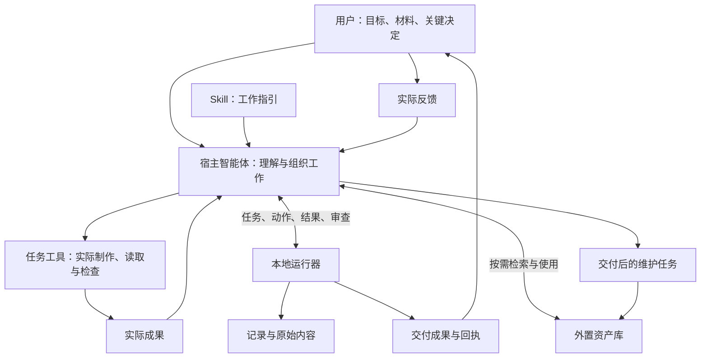
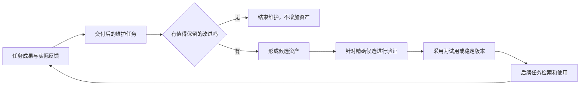

# 从任务到成果：理解 AstroFairy 的完整逻辑

面向第一次接触本项目的读者。阅读本篇不需要懂 Python、数据库或智能体框架。

本篇解释初版 `22b7ece5d8388379f7b4bcaf47de4c047173cd9b` 的设计和实际职责。
“当前行为”在本文表示冻结初版行为；“设计目标”表示希望取得的效果；
“待复核”表示效果、充分性或行业水平仍需取证。本文不提前认定当前方案已经最优或达标。
十六方面取证后的[整体结论](../reviews/overall-assessment.md)已形成；取证完成、问题修复和实际效果达标分别记录。
后续实现变化见[修复工作区](../repairs/README.md)和[当前运行机制](architecture.md)。
开发期不承担旧数据或旧接口兼容；当前实现采用协议与存储格式 7，不提供旧库迁移。

可以先读第 1–6 节掌握一次工作，再读第 7–11 节理解学习、边界和长期演化，最后用第 12 节参与复核。

## 1. 星灵解决的是什么问题

假设你给智能体一份活动材料，让它做内部复盘演示文稿。一个可用结果需要同时解决几件事：

- 读懂材料，判断汇报是帮助谁做什么决定。
- 组织内容，区分事实、计算、解释与建议。
- 生成能实际打开和使用的文件。
- 检查数据、逻辑和格式，说明材料不足之处。
- 让审核者知道内容怎么组织、检查依据是什么。

这些工作不应由用户预先设计。星灵的目标是让智能体承担组织责任，用户只参与关键判断。

设计目标可以概括为：**简单委托、有序执行、可靠交付、保留依据、逐步复用经验。**
它面向多种轻量任务，投入应与任务相称。目标中的“可靠”需要依靠适用的检查和真实效果验证，
不能从生成了一份回执就推断所有内容正确。

## 2. 你安装的到底是什么

星灵以 skill 包分发。可以把 skill 理解为现有智能体可以读取的一组工作指引，以及随包携带的辅助工具。

智能体应用本身称为**宿主**。你和它对话，它提供模型、会话、工具权限与工作环境。
星灵在其中提供任务组织方式和本地运行器。运行器是一组执行固定规则的脚本。
模型仍由宿主提供，初版无需另配模型账户或 API key。

这几样东西的作用不同：

| 角色 | 负责什么 | 日常类比 |
|---|---|---|
| 用户 | 提出目标，提供材料，决定关键取舍，评价成果 | 委托工作并作关键决定的人 |
| 宿主智能体 | 理解、调查、组织、选择工具、执行和判断 | 负责把事情做成的工作人员 |
| skill 指引 | 告诉智能体如何采用星灵的方法和工具 | 简短的工作说明 |
| 本地运行器 | 按固定规则保存任务、接收动作和检查状态 | 任务登记与流程控制设施 |
| 任务工具 | 读取、计算、制作文件、检查或浏览资料 | 工作中实际使用的设备 |
| 资产库 | 保存可复用的方法、工作流、案例等 | 按需查阅的工具与手册库 |

例如，星灵可以要求检查真实 PPT，但能否渲染 PPT，取决于宿主是否有合适工具。
运行器不会因为装好了 skill 就自动拥有所有格式的制作和验证能力。

## 3. 先看整个关系

图中箭头表达逻辑联系。初版对宿主直接执行的动作主要接收其报告，不能完整监控宿主全部工具。
通过运行器注册并实际调用的工具，则会留下运行器观测到的调用结果。

这里需要同时掌握两个方向：智能体负责推进；运行器负责其控制范围内的记录与规则。
目前的设计依赖宿主配合，并不是一个能够强制隔离宿主的安全系统。
这项分工是否足够、是否值得，属于正式复核对象 A02、A03。

[R06 复核](../reviews/R06-deterministic-and-model-boundaries.md)确认，脚本确实负责记录、字节保存和完成门，
内容是否真实、组织是否合理仍要模型判断。一次首次使用样本没有提问便完成简报，但仍需多次内部操作，
不能因此认定模型负担已经最小。还发现：新工具只报参数名、不说明值的类型和限制，出错时又省掉具体原因，
会把本可明确说明的工作推回模型猜测。这项接口缺口已记录，尚未修复。

## 4. 一次任务，究竟需要记住哪些东西

为了理解全过程，可以先记住六个概念。

| 概念 | 含义 | 活动复盘的例子 |
|---|---|---|
| 请求 | 用户最初交代的工作 | 根据附件制作内部复盘演示文稿 |
| 目标与假设 | 智能体对工作结果的解释，以及暂用的前提 | 帮助管理层决定下一期如何投入；先按内部读者组织 |
| 验收准则 | 判断工作是否达到要求的条件 | 数字可复算、建议有依据、文件可用、未审批事项有标记 |
| 动作与结果 | 做了什么，以及实际得到了什么 | 读取材料、计算指标、生成文件、执行结构检查 |
| 成果与审查 | 哪一份文件是当前成果，对它作了什么判断 | 第 2 版演示稿及对应的数据和语义检查 |
| 回执 | 当前任务的可检查记录 | 请求、假设、输入、调用、成果与审查依据的汇总 |

其中“验收准则”十分重要。准则若太弱，流程即使完整，成果也可能无用。
初版默认准则只有“回应目标”和“内容非空”，需要宿主根据具体任务补足。
默认值能否有效引导宿主，是待复核事项，不把默认通过等同于成果优秀。

## 5. 用一份演示文稿走完工作过程

以下是帮助理解的例子，不是一次新执行记录。

### 第一步：明确任务

你提供活动材料。智能体先读材料，调查能自行查清的事实，再推导可工作的目标和准则。

材料可能说明：报名增加，到场变化不大，直接成本上升，下一期预算未审批。
智能体可以据此组织“结果变化—原因线索—证据限制—下一步建议”的叙事。
这个组织方式来自判断，运行器不能仅凭固定规则决定最合适的叙事。

如果受众只影响排版，智能体可以先采用可逆的默认值并说明假设；
如果任务要求对外发布而授权不清楚，就需要用户作关键决定。
判断何时问、问什么，仍依赖宿主能力，初版只提供有限的提问约束。

### 第二步：实际产出

智能体可以查找已有复盘工作流，也可以自行组织工作。
它调用可用的制作工具形成文件，把文件字节登记为本次任务的输出，再指定当前成果。

“已产生某个文件”和“文件已成为当前待验收成果”是不同的信息。
保存这一区别，是为了明确后续检查和交付究竟针对哪份内容。
运行器记录了输出引用，并不会自动判断它就是用户想要的演示文稿。

### 第三步：检查实际成果

能够机械检查的项目交给工具，例如文件是否为空、包结构是否可解析、金额计算是否相等。
具体格式的深入检查需要相应工具，初版内置检查器本身并不包含 PPT 渲染器。

需要理解的项目由模型审查，例如汇报是否切题、重要信息是否缺失、建议是否超过材料支持。
模型审查是有来源的判断，仍可能出错。对高重要性的结论，可以另外安排独立复验。

如果没有渲染工具，能够核验结构和文字，就应说明已核验的范围和未验证的视觉效果。
是否可以交付，要结合本任务必要条件判断，不能用结构可解析证明排版没有问题。

### 第四步：如实交付

在必要检查满足、没有待答问题或不确定调用时，任务可以完整关闭。
无法满足全部要求时，可以交付有价值的部分成果并说明缺口，或结束为失败、取消。

初版每个任务有一个主成果和一份回执。多文件任务如何稳定地组织附件、源件和预览，
[R05复核](../reviews/R05-deliverables-and-evidence.md)已用真实PPTX和讲稿证明可以打包交付。
原生导出只选最后一个主成果，因此需要把必要文件组成交付包并检查成员，不能把工作区里存在文件等同于已经交付。

你日常收到的应当是成果、简短的说明和回执入口；任务编号及内部协议由智能体管理。

## 6. 任务改变、失败或中断时会怎样

### 改变要求或替换成果

[R03的实际模型试用](../reviews/R03-user-experience-and-guidance.md)覆盖了一句模糊请求、普通语言改稿和一个缺少硬预算的任务。
成员只用普通语言交代，前两段没有额外提问，第三段只需回答预算；编号、JSON和版本整理由宿主处理。
这说明该分工在所测条件下可行。解释器、技能入口及获准目录已具备，且没有团队真人参与，不能由此认定所有首次使用都无负担。

任务要求与成果都有版本意义。你改变受众或约束后，先前的评价可能失去适用性；
智能体修改文件后，先前针对旧文件的检查也不能继续证明新文件正确。

初版会让检查绑定任务修订和成果登记版本。明确来自用户的要求有额外修改约束。
具体来说，额外约束作用于标记为用户来源的验收准则；对目标解释是否忠实，仍需要宿主判断与后续复核。
这些规则可以防止一部分过期检查，但仍依赖宿主如实转发用户意图、制定适当准则。

[R04 复核](../reviews/R04-protocol-and-recovery.md)也确认了实现中的三个连接问题：
“状态没变才继续”的条件在部分路径失效；初始配置报错时可能已经留下任务；
数据库出错时不能总按约定返回机器可读原因。这些已记录但尚未修复，不能将设计目标直接当作实现保证。

### 出现相反判断

如果一条审查指出错误，后来的一条通过不能自动抹掉它。
重新判断需要明确关联此前审查，并说明依据。这样审核者可以看到为什么改变结论。

这是设计要求。R05发现一条尚未修复的例外：文件内容和任务要求完全没变，只重新登记同一成果，
旧的失败或未知判断就可能不再阻止完整关闭。另一个条件性问题是，扩展检查器明确报告检查旧文件时，
运行器仍可能把通过归到当前文件；默认内置检查器没有这一错接。两者说明需要复核的不仅是“有没有检查”，还有检查与结论是否始终对应。

### 执行中断

假设智能体请求写出文件，执行后却在记录结果前中断。此时系统不能简单认定“没有执行”，
否则重试可能重复产生效果；也不能认定“一定成功”。

初版先记录开始，再记录观测。中断可能留下待处理或不确定状态，完整交付会被阻止。
重开相同数据目录可以重建任务状态。R02 进一步确认：对于已经留下 pending/unknown 的注册工具调用，
初版公开协议也没有把事后核对结果补记到原调用的入口；不是仅缺自动恢复。
目前可诚实结束为部分或失败，再安排后续任务。是否增加同任务核对继续，以及怎样继承证据，
见[R02 的 D01](../reviews/R02-core-architecture.md)。这项复核记录尚未改变运行机制。

[R14复核](../reviews/R14-authorization-data-and-security.md)又确认了一项扩展条件下的例外：
运行器只把名称恰好为`write`的效果异常保留为未知。扩展工具若采用已授权的`send`、`delete`等名称，
效果已经发生后报错，也可能被记为失败，允许相同调用再次执行。内置写操作的对照能正确阻止重试。
后续须明确效果分类契约，不能只凭“报错了”判断“没有发生”。该问题也尚未修复。

### 预算不足

预算用于限制部分调用和内容规模。它有助于避免无限推进，但并不直接代表实际模型 token 或总耗时。
智能体仍需要及时停止无收益的工作，选择诚实的交付结果。预算是否设置合理，要实测。
R03确认了一项尚未修复的提示问题：额度归零时，下一步可能过早建议失败或部分结束，
即使已有结果只差回传，或只差用户回答，而这些操作不再消耗调用额度。
“不能再发起新调用”和“已有工作无法完成”应当分开判断；仍需新工具检查的任务，也不能凭空跳过检查。
另外，调用数有限不代表每次工作包都小：当前 next 会带回全部用户修订，修订越多，重复传输越多。
如何忠实保留要求又按需取用历史，是[R02 的 D02](../reviews/R02-core-architecture.md)移交的后续事项。

[R07对照复核](../reviews/R07-speed-and-economy.md)让两个全新模型上下文各做同一个短任务：两份成稿都满足主要要求，
使用星灵的一路留下了更多结构化证据，也做了更多协议操作。它们执行子进程只花了很少一部分观察时间，
其余时间尚不能可靠归到模型、调度或记录。因此现在不能直接说星灵总体更快，或把调用次数换算成真实token和费用。

## 7. 为什么要有记录，又能相信记录到什么程度

初版保存两类基础材料：原始内容字节，以及发生过的事件。
可以将前者理解为材料与成果的留样，将后者理解为按顺序保留的工作历史。

当前状态是依据这些历史重建的，回执则是为交付生成的汇总。
只要基础内容和事件仍在，导出失败后可以重新生成回执。

回执是带有历史序号的快照。R04 实测：工具在任务关闭后才返回，事实仍会保存，
但原回执需要重新导出；并发导出也可能暂时留下旧快照。因此审核时要区分“最新任务历史”和“某次导出的回执”，
不能只看已有文件就认为它一定包含最后一条信息。刷新和核对责任应由智能体承担。

回执中的证据引用也不等于交付包已经包含该证据正文。R05的陌生审核能看懂公开论证，
但若要重现作者的历史检查，还需要额外取用检查输出、程序或版本信息。
数据可以仍在本地库中，取用路径却不够顺手；后续应由智能体补好审阅入口，而非把排错工作交给用户。

还要区分“私有核查资料”和“可以给新受众的资料”。详细回执会保留原请求和工具参数，可能带有敏感内容。
本地文件有私有权限，也不代表适合直接发给他人；交付或分享时应由智能体按接收者和已有授权检查披露范围。

每份内容有一个由字节计算出的标识，读取时可以检查是否仍然一致。
事件也相互连接并校验。这有助于发现一些数据损坏或不一致。
它们不能证明记录者从未说错，也无法阻止控制代码和数据库的宿主一起改写内容及校验值。

你审核时需要分清三种证据：

| 证据 | 可以支持什么 | 仍不能单独证明什么 |
|---|---|---|
| 运行器实际调用工具的回执 | 注册调用发生并返回了某个结果 | 工具本身绝对正确、所有任务要求都已满足 |
| 宿主提交的工作报告和模型审查 | 宿主陈述了工作与判断，并给出了依据 | 独立主体已经复验、叙述一定真实完整 |
| 用户的实际反馈 | 某次使用中用户观察到的效果 | 对所有人、所有任务都普遍有效 |

“可分析”的价值，是让这些关系能够被追问和重建。是否足够容易重建内容组织，还要让真实审核者验证。

## 8. 学习怎样发生

学习的目标是改善后续工作。成功方法、错误纠正、明确反馈、重复任务结构和有效工具选择，都可能提供依据。

初版的设计路径是：

运行器不会自动从你的所有对话里提炼知识。宿主需要识别值得维护的经验，并发起相应动作。
候选通过验证，也只能支持当时的采用判断；稳定成熟程度、是否真的节省工作和提升质量，需要后续使用证据。

比如一次复盘受到好评，值得保留的可能是“先给结论，再解释变化，最后明确证据限制”。
本次活动名称和金额则是任务事实，不能作为通用规则塞进下一份复盘。
个人偏好也需要保留适用范围，不应自动成为所有人的要求。

使用者的表达和判断能否逐步改善，也属于目标。当前尚未取得长期证据，不能因保存了偏好就认定目标已达成。

[R08学习复核](../reviews/R08-learning-and-feedback.md)已实际走过一次受控回流：七个合成任务只保留一份试用方法，
另一个全新模型上下文在新材料上检索并使用它，也没有把它套到无关的生日祝福中。
空库对照同样完成了任务，所以这证明方法可以传递和有范围地使用，还没有证明整体效果更好。
这些反馈均为明确标注的模拟反馈，不能当作团队成员满意或长期进步的证据。
维护时有些原始依据还需额外读取完整历史或原件；保存了引用，并不表示后续任务已经拿到了全部证据正文。

## 9. 资产库、工作流与检索分别是什么

**资产库**保存不同用途的可复用内容：方法、案例、个人偏好、行为约束、工具说明和工作流。
初版的工具说明是资料，读入或导入它不会安装或执行代码。

**工作流**是一种结构化资产，说明输入、参数、步骤，以及每一步到什么条件才算完成。
宿主读取后按它执行；初版并没有一个可以无条件自动运行任意工作流的独立执行引擎。

还要区分两种“包”：安装AstroFairy用的是Agent Skills技能包；分享一次积累的方法，用的是项目自己的资产JSON包。
后者不会因技能包符合共享规范，就自动成为通用工作流交换标准。
收到资产包后，要在本地重新验证它是否适用；摘要一致只说明内容身份，不能证明来源真实、依赖齐全或拥有分享权利。
初版分享保留方法与来源说明，不附全部原任务、私有附件及验证历史；需要这些证据时必须另外安排合法可取得的材料。

[R09工作流复核](../reviews/R09-workflows-reuse-and-sharing.md)实际修订并分享了一份合成方法：它教下一次任务先确认统计口径，
而不是记住上一次的金额或比例。全新接收端只用分享包与自己的新材料，完成了本地验证和一次正确复盘。
这说明有限场景的方法可以传过去、用起来；仍不能把试用状态叫作长期成熟，也不能把一次成功当作普遍净收益。

[R10长期演化复核](../reviews/R10-long-term-evolution-and-growth.md)进一步区分了“小核心”和“总量不增长”：
同一份原件可以只存一次，但每次任务的历史、回执和交付副本仍会增加。退役方法只是让新任务少选它，历史仍保留。
备份负责恢复，清理负责决定可以删什么，行数预算负责提醒检查；三者不能互相替代。
独立复验已补齐，并确认了未知库版本在拒绝前执行旧版建表的顺序问题，尚未修复。
有限演练仍不能作为长期可持续性的正式通过结论，数据寿命和升级政策也不能只靠版本数字表达。

**检索**负责找到可能有用的资产，读取后还要判断它是否适合本次任务。
初版把查询拆成词项，在名称、摘要和标签中做子串匹配评分，返回有限数量的活跃版本。
当前没有部署向量数据库、嵌入模型或自动 RAG 管线。

用熟悉的语言说：全文检索利用文本索引找词；语义检索尝试找到意思相近的内容；混合检索结合不同方法。
向量库可以是语义检索的一个组成部分，选择它还需要考虑资料组织、模型、更新、权限和评价。
有关方案列在权威来源目录的 S15、S28–S30、S38，正式复核才作适用性和效果比较。

因此，即使资产库中有“活动经营分析”，它能否在用户说“这个活动值不值得继续办”时找到正确方法，
目前需要实际测试。成熟检索路线是否应替换或补足初版，将在 M30、U03 的复核中判断。

R07已经做了一小轮比较：全文索引能显著加快某种元数据查询，但在几条长自然语言问法上，
它和当前词项查找都没有找到目标。这个小测试还没有让宿主提炼关键词，不能代表所有实际查询。
向量库又解决了另一类相似度查找；精确找到最近的向量，也不保证找到了真正适合任务的资料。
需要把“资料如何表示、怎样提问、找回哪些内容、最后是否有用”连起来检验，不能只看是否用了RAG或向量库。

同轮还确认了一个尚未修复的基础问题：某些Unicode词从资产中原样复制查询，也会因查询与资料两端的大小写处理不同而漏检。
这可以先用一致的字面匹配规则修正，不需要先引入更大的检索系统。实际语义检索与维护取舍继续在R09复核。

## 10. 资产如何修订、退役和分享

一个经验可能先是候选，经验证后进入试用或稳定状态。改进内容需要形成新版本，旧任务仍可以引用原版本。
如果新版本不适用，可以退役。初版会选择仍活跃的版本，因此退役最新版本有可能重新显露旧版本。
这是否符合使用者预期，需要在版本选择复核中检查。

分享采用文件包：发送方导出选定资产，接收方导入为候选，经过本地验证再采用。
发送方的经验说明会作为发送者声明保留，并不变成接收方亲自观察到的事实。
包内不会自动带上发送方的完整任务账本和附件；复用所需的工具或私有资料仍需另外核对。
但资产正文和证据说明本身也可能包含任务事实或敏感信息，仍需按接收者核查。
导入时摘要相符，只表示包内内容与标识一致，不认证发送者身份，也不证明经验真实有效。

当前 personal/team 是本地分类范围，不是账户权限或远程团队服务。
成熟工作流能否逐步收敛、多人分享后能否保持可靠，需要通过整个发送到复用的路径验证。

## 11. 什么应该增长，什么应该保持稳定

设计目标是让方法、工具、案例和工作流在外围积累，核心维持少量通用职责。
遇到新任务时，先增加适合它的资产或能力适配，尽量沿用原有任务与检查机制。

但“把资料放在外面”本身还不够。还需要检查：

- 资产增多后，检索是否仍然准确、快速。
- 新任务是否不断迫使核心增加特殊分支。
- 历史记录、重复版本和失效资产是否有适当寿命。
- 工具及宿主变化后，修改是否能局部完成。
- 新增机制的维护成本是否小于实际收益。

初版有入口和部分核心文件的体积预算，这是一道提醒机制。复杂度可能转移到其他文件，
因此正式复核还要观察职责、依赖和变更影响，不能单凭行数判断长期简洁。

### 安装和开发保障为什么也属于架构

标准 skill 目录是主要交付单元：里面的说明和运行器应当一起移动，离开开发者的电脑仍能运行。
ZIP 是传输这个目录的一种方式，可选 Python 包则从相同代码构建。
宿主专用展示信息和插件清单放在外围，让公共入口保持通用。这些分发路线是否真正兼容，需要分别实测。

任务与经验数据放在安装目录外，是为了更新工具时保留工作积累。R12中，五种安装布局分别完成了同版本重装、完整移除和再安装，
历史任务与候选资产仍可读取。这支持代码与数据分离，但没有证明跨版本迁移；R10还发现未知库版本的拒绝晚于旧格式DDL，保持未修。

“兼容某应用”有几层：格式符合、文件安装到位、应用识别、实际触发、任务交付。R12新增了Codex本机原生识别的四个控制，
其余应用仍主要是安装器与脚本证据，所有原生模型触发和实际交付仍待证。共享技能目录也可能同时供多个应用读取，
因此针对一个目标的卸载命令成功，不一定代表文件已消失。插件市场托管和云端同步另有宿主规则。

初版运行器没有第三方Python依赖，不代表底层库能力没有要求：资产检索用了SQLite窗口函数。
Python3.12本身不保证这项能力，R12-D01记录了依赖说明缺口；当前机器运行正常，旧库整栈未测。
基础doctor能检查解释器和目录，不能代替首次环境准备、所有数据故障诊断或下一会话持久性证明。
完整矩阵和限界见[R12分发复核](../reviews/R12-distribution-and-host-use.md)。

开发时，版本和字段尽量只定义一次，其余文件从它们生成；提交检查和远程 CI 执行测试与构建，
帮助发现不一致。它们能阻止已覆盖的错误，实际产品效果仍需要独立的任务和用户证据。
这些开发保障同样属于全量复核范围，维护负担也要计入，而不是无限增加检查和规则。

[R16复核](../reviews/R16-documents-development-and-public-claims.md)说明了为什么检查工具自身也要验证。
冻结初版确有一次公开远端CI成功，当前47项测试也真实执行；但在副本新增一个开发子目录测试后，
目录结构可能使失败测试未被发现，完整入口仍报通过。单源版本生成器也可能忠实复制同一输入，却输出不符合目标版本规范的字符串。
两项产品检查机制问题尚未修复，当前版本和已有47项测试没有被判成失败或漏跑。

因此，理解开发保障时要分开问：规则是否明确、数据是否来自单源、实际执行是否覆盖它、故意放入错误能否被拦住。
成熟工具能承担各自职责，项目仍需把它们正确接起来。测试数量和绿色状态提供有限证据，不能自动证明全部承诺。
现行进度只从索引与状态台账读取；有日期的历史报告保留当时事实，避免把旧结论改写成今天的成功。

## 12. 你怎样参与复核

你无需先学会内部命令。可以围绕下面六个问题判断任何设计：

1. 这个设计解决什么问题？没有它会发生什么？
2. 谁负责这个决定，依据从哪里来？
3. 怎样知道动作真的执行、结果真的达到要求？
4. 已有成熟方案是什么，当前为什么这样选？
5. 它给用户、模型和维护者增加多少负担？
6. 任务、工具和资产增长时，它会怎样变化？

这些问题分别帮助你追问必要性、责任、证据、行业水平、成本和演化。
你也可以沿着一次失败或修改反向追问：在哪一步发现、哪个主体处理、哪些检查需要重做、还有什么没解决。

正式复核使用一份总清单和一份全量对象台账。总清单规定审查维度，台账保证每项架构、机制和连接都得到审查。
FDP 用于约束设计复核的取证与结论形成；行业判据回到各自的权威原文。
已经使用成熟组件的部分，也要检验它在本系统中的配置、连接和实际保证。

## 13. 阅读后可以回头解释的几个问题

这些是自查理解的提示，无需填写或提交答案：

- 为什么“模型说检查通过”和“某个工具实际完成某项检查”要分开？
- 为什么修改成果后，需要重新检查？用户改要求又影响什么？
- 为什么保存了一份工作流，还不能说明学习已经有效？
- 为什么任务历史和经验库需要不同的用途与生命周期？
- 为什么一个本地哈希链不能提供独立审计认证？
- 为什么采用向量检索既不是自动正确，也不应被未经调查地排除？

## 14. 查阅路线

- 想看整体准备和正式复核顺序：读[复核准备入口](../reviews/README.md)。
- 想看每项设计、机制及定位：读[全量对象台账](../reviews/system-inventory.md)，其机器数据在同目录 JSON。
- 想看需要验证哪些要求：读[总复核计划](../reviews/initial-review-plan.md)。
- 想追问行业依据：读[权威来源目录](../reviews/authority-sources.md)，每项都标明来源、版本和使用限制。
- 想看实际操作：读[运行指南](operation.md)及 skill 中的宿主协议。

本文的内部行为依据是冻结初版源码，具体对象到文件和符号的位置关系见全量对象台账。
外部背景依据分别由官方 Agent Skills 规范、SQLite/语言接口文档、检索原始研究与成熟实现提供，
见来源目录 S01、S13–S18、S23–S31、S38–S39。示例中的组织方式用于解释逻辑，不宣称已通过正式复核。

## 15. 复核之后，怎样理解当前项目

本次十六方面的取证已结束，具体见[整体结论](../reviews/overall-assessment.md)。这只表示已经系统检查并留下结论，
不表示发现的问题已修，也不表示真实团队长期使用效果已达标。

可以保留的方向是：用户提出任务，宿主负责组织；小运行器管它能确定的规则和记录；方法、工具与工作流放在外面按需取用。
标准skill目录、已有分发工具与SQLite等成熟设施继续承担各自职责，没有依据要求推倒重写成大型平台。

当前需要补好的是连接处的保证：失败不能因同内容重发而消失，检查必须对应实际对象，副作用不确定时不能轻率重试，
序号与版本准入不能有例外分支，测试也不能因为目录形状而漏跑。这些不是要增加更多用户步骤，主要由机制和开发检查承担。
取证收口时有13项确认问题和2项边界候选开放，初版已有47项测试的正常结果也一并保留。
后续修复状态从[修复台账](../repairs/status.json)读取，本文保留初版问题与推导过程，不充当实时通过清单。

随后应在明确的宿主、任务、资料和工具范围内做真实试用，观察成员是否省心、审核是否容易、成果是否能实际打开使用、
重复任务是否受益。一次模型完成任务、一次模拟好评或一个trial标签都不足以证明这些长期效果。

69个复核对象是观察系统的切面，不是69个运行模块；16轮复核是开发过程，不是用户每次使用都要走的流程。
日常入口仍应简单，检查报告和研究原件留在开发档案中按需读取。学习应扩展可选工具和方法，而不是让每个使用者背更多规则。

## 16. 后续修复怎样改变日常工作

[修复工作区](../repairs/README.md)记录初版之后的机制更新。任务现在先完整确认初始约定，再创建记录；
输入不合法时不会留下一个缺少假设的任务。过期请求会在实际动作准入时拒绝，检查也不会中途换成另一个目标。

预算用完只代表不能再发起新调用。已有结果仍可以回传和登记，已有答复仍可处理，纯语义审查仍可能完成交付；
必要的机械检查与未决副作用不会因此被放过。工作包中的任务版本和用户答复来自同一次记录快照。

学习任务读取一份一致的源记录快照并建立独立任务，原任务不变。这些连接保障由脚本承担，成员仍用普通语言提出任务和关键决定。
当前哪些问题已经复验、哪些仍开放，读取[修复台账](../repairs/status.json)，不从本文推断整体已经验收。

## 17. 工具怎样减少参数猜测

后续工具契约改造让“这个工具接受什么”成为可读取、实际执行的标准模式，而不是仅有几个字段名。
不合适的参数会在调用前拒绝，合理拒绝会说明可纠正的原因；真正执行后无法确认的写入仍不能当成安全失败重试。
智能体平时只看简短摘要，需要时才读取完整规则，复盘时能取回当时的定义，成员不必管理这些记录。

实际验证使用成熟库，环境由智能体在获准位置一次准备并复用，取消了初版“不需第三方包”的前提。
这部分实现后的独立复验进度见[F03](../repairs/F03-declared-tool-contracts.md)，不能把设计通过当作产品已经验收。

## 18. 为什么原样搜索也可能出错，怎样消除这类错误

旧检索让问题文字和资产文字采用不同的大小写规则，所以复制已存在的外语词也可能搜不到。
后续改为两边共用 Python 的标准 Unicode 大小写折叠；标签只按真实文字搜索，不把存储时的引号、转义和括号当标签。
先选择当前已采用版本，再判断是否匹配，避免新版本已经不适用时又悄悄推荐旧版本。

这仍然是元数据的字面检索，不会自动理解近义表达，也没有额外统一所有 Unicode 拼写形式。
没有结果时，智能体仍要判断是否换词、查标签或自行组织任务；不能把缺少结果当成缺少可用经验的证明。

Python 的版本也不能单独证明底层数据库具备所有所需能力。环境诊断现在用临时内存数据库实测，
实际开库前再用同一规则准入，失败时不给已有任务目录改权限或写库。成员不用学习数据库版本，环境仍由智能体准备。
本批进度见[F04](../repairs/F04-unicode-discovery-and-sqlite-admission.md)，真实团队检索效果和长期收益仍需实用验证。

## 19. 为什么包版本与插件版本的写法不同

Python 包与插件清单采用不同的版本语法。例如包里的 `1.2.3a01` 按 Python 规范表示 `1.2.3a1`，
对应插件版本应写成 `1.2.3-alpha.1`。直接拼接原数字会产生带前导零的非法插件版本，即使所有文件互相同步也会错。

开发生成器现在先用成熟解析器取得版本含义，再按明确范围生成目标版本，保持版本次序与身份的对应关系。
不能按这套规则保留含义的版本形式会被拒绝，原版本源不被悄悄改写。
这部分由开发工具统一处理，日常任务仍由成员自然表达需求、智能体组织和执行。
生成合法版本本身不证明每个宿主的实际安装或升级行为；本批证据与限界见[F05](../repairs/F05-package-to-plugin-version-contract.md)。

## 20. 回复丢失后，怎样知道原操作发生了什么

工具提交了远程文档生成任务，回复却丢失，原调用就可能留下未知记录。此时直接再提交，可能产生第二个任务；
模型说“应该成功了”也没有新增事实。可核对的工具需要按原尝试标识取得权威终态和可对应的完整结果。

支持这类核对的写工具会提前指定受信的只读核对工具。智能体按普通工具方式调用，脚本验证原尝试、合同和结果的对应关系，
自动派生“效果已核实”的状态。原来的未知记录保持原样，成果还要按当前要求检查，核对本身也不授予重试许可。
没有可信核对方式或答案仍不确定时，会如实部分交付、失败或取消。

若后来出现互相矛盾的正向结果，争议会持续显示，后来的相同答案不会把它洗掉。历史交付决定保留，当前证据是否可信另行呈现。
已经发送的文件或采用的经验不会靠一条新记录自动收回。记录先持久保存，再更新回执；回执更新失败可以重导，事实不会回滚。
这些工作由智能体与脚本承担，成员继续使用自然语言提出任务与关键选择。本批进度见
[F06](../repairs/F06-authoritative-attempt-confirmation.md)，整个工作包的增长见下一节。

## 21. 后续修复：完整记录与眼前需要读的内容分开

可以把一次任务想成一本逐渐变厚的工作档案。档案必须保留原要求、补充说明、执行记录和检查依据，
但每次问“接下来做什么”，没有必要把整本档案重新放在桌上。

现在，面向智能体的每次命令回包都有固定大小。内容较少时直接展示；内容较多时给出当前动作、状态、数量、
需要处理的调用标识和一份固定版本的完整档案地址。智能体可以先看目标或检查标准，再看某条新补充或执行详情。
这些阅读不占执行次数，任务已经关闭也能读。使用者仍然只提出任务和回答关键问题，不需要管理地址、编号或翻页。

这不是把旧内容摘要后丢掉。完整原文仍然存在，分段合起来可以还原；每一段都属于同一个固定版本。
后来的反馈会形成新版本，不会让读到一半的旧档案悄悄变成新内容。读取地址也不等于工具事实：
成果是否可靠，仍要看原来的执行来源和检查依据。

学习任务拿到的是一份小型目录，指向当时的完整档案，包括原始补充、反馈、调用和检查记录。
因此，一次较大的任务不会仅因为档案超过普通材料大小，就失去学习入口。智能体需要阅读相关依据，
不能从“已经有目录”推断“已经理解全部内容”。

这解决的是每次必须送到智能体眼前的信息量。保存的档案仍会增长，重新计算状态仍要处理历史；
F07当时多个变化后的完整快照也会多占空间，甚至比原始记录增长更快；下一节给出后续改进。没有自动删记录、无限资源或永久恒定速度的承诺。
宿主对话本身何时整理、长期数据何时保留或归档，是相邻职责，不能由一个小回包冒充已经解决。
设计与本批验证见[ADR-0009](../adr/0009-bounded-agent-responses.md)和
[F07](../repairs/F07-bounded-agent-responses.md)。

## 22. 后续优化：旧档案共用内容，查一页不再翻整本

上一节解决了每次回包的大小，本节进一步处理档案背后的保存和阅读成本。
现在可以把多个版本看成共用资料页的档案：没有变化的内容只保存一份，新版本追加记录时复用已有内容。
旧版本的地址依然有效；没有偷偷删掉依据，也不需要成员手工整理。

阅读一个小节时，系统核对通往该小节的目录和实际读取的内容，不再每次重新解析完整档案。
这项核对只说明读到的部分可靠。另有一次完整审计，可以检查整本档案，发现尚未读取的部分是否损坏。
两种保证必须区分，否则“这一页读到了”就可能被误解为“全部资料都没有问题”。

档案地址和所选小节的标识是结构化内容的承诺，不能当作普通成果文件的摘要。
完整审计会另外给出可与全文核对的摘要。编号、读取和核对仍由智能体与脚本管理，成员不增加操作步骤。
第一次多人同时保存档案时，采用成熟的系统文件锁串行建立归档；锁不支持或旧归档异常就明确拒绝，
不会擅自清空资料，也不会因为进程退出留下一个永远占用的模拟锁。

资源改进有明确适用范围：连续追加记录可以复用旧部分；在前面插入内容仍可能重建后面的目录。
形成快照仍需处理当前完整数据，完整审计仍需遍历内容，重新计算任务状态的历史成本也尚未优化。
长期保留、备份恢复、真实成员体验和学习净收益，继续列在[完整工作范围](../repairs/work-program.md)里。
原问题清单的15项技术修复，与整个产品获得终验，是两件分别取证的事。
设计见[ADR-0010](../adr/0010-shared-authenticated-documents.md)。

## 23. 后续优化：档案保留多久，出问题后怎样恢复

“资产退役”和“资料删除”是两回事。退役表示不再优先选择这个版本，过去任务用过它的依据仍然保留。
现在事件、材料、资产版本和档案块都不会自动过期或被清理。好处是旧引用能继续复核；代价是空间会增长，
需要部署者安排容量和备份，不能把“核心没变大”误解成“所有数据永远不变大”。

普通提交原来会为了回复状态重复翻阅同一段历史。现在保留必要的一次完整核对，去掉后面多余的重复读取。
没有直接保存一份未经验证的“当前结论”来跳过旧依据：结论的摘要能证明字节相同，却不能证明推导过程正确。
因此历史很长时仍有成本，这项边界会继续测量；不是宣称任何任务都恒定时间完成。

备份也不能只复制一个看起来像主数据库的文件。学习档案存放在另一份归档中，遗漏它就会留下打不开的引用。
现在智能体可运行正式的备份和核验：先取得主库的一致副本，再取得只追加、不删除的文档归档副本。
后者可以多带一些新文档，但必须包含前者已经引用的文档。共享内容只需做一次节点语义核验，避免每个旧版本重新检查全文。

恢复会写入全新的目录，核对内容和引用后才宣布成功；中途失败的目录会被标记并阻止使用，不覆盖正常运行的数据。
已经捕获的原件和任务记录可恢复，成果和回执可以重新导出；尚未捕获的工作区文件、工具环境和外部服务状态需要另行保留。
一次写入当时是否成功仍须按事实核对，备份本身不会把未知结果变为失败，也不会自动重试。
这些维护步骤由智能体和脚本处理，成员仍只提出任务并回答必要的关键问题。
设计见[ADR-0011](../adr/0011-record-lifetime-and-state-recovery.md)。
