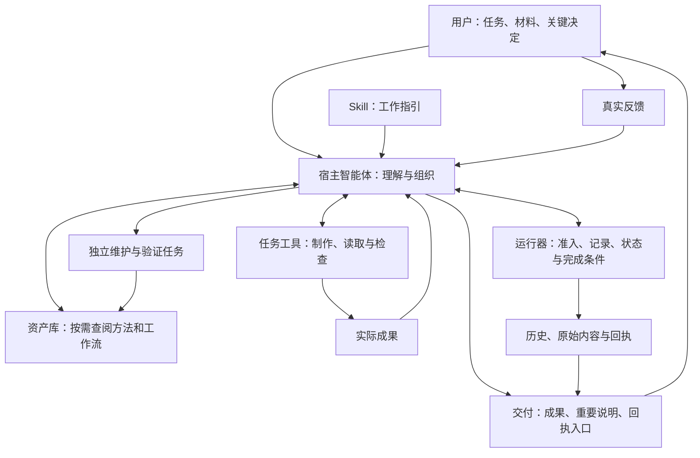
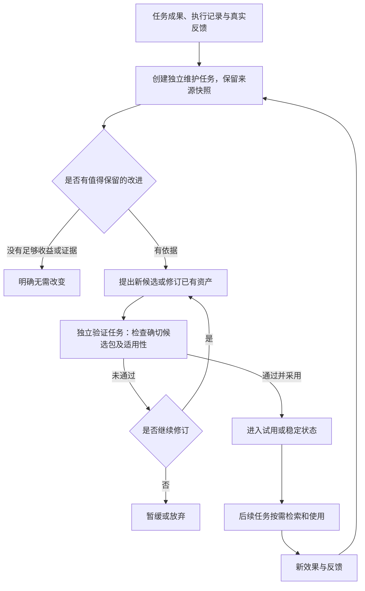

# 从任务到成果：理解 AstroFairy 的完整逻辑

面向第一次接触本项目的读者。阅读本篇不需要懂 Python、数据库或智能体框架。

**版本基准：`0.1.0a2` Alpha；文档更新日期：2026-11-03。**
本文对应完成整体优化和独立技术复验后的版本，准确能力与限制见[本版发布说明](../releases/v0.1.0a2.md)。
[技术验收](../optimization/2026-11-acceptance/final-2026-11-03/README.md)保留发布准备之前的冻结结论；
实际发布状态以 [GitHub Releases](https://github.com/Etoileint/AstroFairy/releases) 为准。
本文把当前实现整理为一条连续的解释，不再要求读者先理解初版、再逐项叠加修复。
早期问题及解决过程保留在[复核档案](../reviews/README.md)与[修复记录](../repairs/README.md)，不作为当前缺陷重复陈述。

先读第 1–7 节，掌握一次任务的工作方式；再读第 8–13 节，理解记录、学习与长期演化；
最后读第 14–18 节，了解行业依据、安装、验证范围和你怎样判断项目是否有价值。

## 1. 星灵要替你承担什么

你向智能体提出一个任务，附上材料，通常并不想先设计工作流程、选择方法、写验收表，最后再替它排错。
你希望它能理解目标，自己组织工作，在必要时问一个容易回答的关键问题，交回可用成果。

但只交回一份看起来不错的文件还不够。你需要知道：它依据了哪些材料、为什么这样组织内容、
哪些结论经过检查、还有哪些问题没有解决。否则，一旦发现疑点，就很难判断应当改哪里。

AstroFairy 的目标是把这两件事结合起来：**使用者的交互保持简单，背后的工作有秩序、有依据、可以追问。**
它面向多种日常交付任务，投入应与任务的重要性和难度相称。

它追求的是在合理资源内交出合格到优秀的成果。结构化流程能减少一些错误和混乱；
实际质量还取决于材料、模型、工具和检查标准，需要通过真实使用继续验证。

普通问答可以直接回答。只有需要形成成果、改稿、保留执行依据或复用方法的工作，才需要进入任务流程。

## 2. 谁在思考，谁在管规则

星灵以唯一技能入口 `fairy`（星灵）安装在你已有的智能体应用中。这个应用称为**宿主**，例如支持本地技能和命令执行的 Claude Code 或 Codex。
宿主提供模型、工具权限、文件访问和对话环境；星灵沿用它们，无需另开模型账户。

星灵的主要分工如下：

| 组成 | 负责什么 | 你可以怎样理解 |
|---|---|---|
| 用户 | 提出目标、提供材料、决定关键取舍、反馈效果 | 委托工作并作必要决定的人 |
| 宿主智能体 | 理解材料、调查、选择方法、制作成果、作语义判断 | 实际组织和推进工作的人 |
| skill 指引 | 告诉智能体怎样采用星灵的流程和工具 | 完整常规主文、阶段工作包与条件参考入口 |
| 本地运行器 | 保存任务、核对动作是否允许、记录执行、判断完成条件 | 按明确规则工作的登记与控制设施 |
| 任务工具 | 读取、计算、生成、浏览、渲染或检查文件 | 实际工作的设备 |
| 外置资产库 | 保存可复用的方法、工作流、案例、偏好等 | 车间里按需取用的工具与手册库 |

例如，“这份汇报应该先讲什么”主要由智能体判断；“这条检查究竟针对哪一版文件”可以由脚本核对。
前者需要理解，后者需要稳定地遵守规则。把两者分开，模型就不必靠记忆维持所有流程细节。

这仍是一套依靠宿主配合的工作方式。运行器能约束经过它的动作，不能隔离或监控宿主的全部行为。
宿主直接完成的工作以其报告留痕；运行器实际调用注册工具的工作，才具有对应的工具观测记录。

## 3. 理解一次任务，只需记住六件事

| 概念 | 含义 | 演示文稿任务中的例子 |
|---|---|---|
| 原始请求与材料 | 你真正交代了什么，提供了什么 | 根据活动附件制作内部复盘演示文稿 |
| 任务约定 | 目标、重要假设和判断是否完成的准则 | 面向管理层；数字可复算；建议不超出证据 |
| 动作与观测 | 打算做什么、是否允许做、实际得到什么 | 读取表格、生成文件、执行检查 |
| 当前成果 | 本次正式拿来检查与交付的内容 | 当前采用的演示稿或多文件交付包 |
| 审查 | 谁依据什么对这份成果作出什么判断 | 计算核对、结构检查、模型内容审查 |
| 回执 | 把上述关系整理出来的交付记录 | 请求、假设、输入、执行及审查依据的汇总 |

任务约定特别重要。运行器可以要求“必要检查都通过”，却不能保证智能体提出的检查标准足够好。
如果只要求文件非空，即使流程完全合规，也不能据此说明演示文稿有用。

当前运行器有基础默认准则，智能体需要按任务补足。人不用填写复杂表格；
但智能体需要把“做得好”变成可检查的条件，并区分你的明确要求、它的推导和运行器固定政策。

假设也需要单独保留。“暂按内部读者组织”是可说明、可修改的工作前提，不能被包装成你明确提出的要求。
编号、版本和记录格式由智能体与脚本管理。

## 4. 用一份演示文稿走完工作过程

下面是解释机制的假设例子，不是新增的真实评测记录。
你提供的材料写明：上一期报名 100 人、到场 80 人；本期报名 150 人、到场 90 人；下一期预算尚未审批。

### 先把任务变得可执行

智能体先阅读材料，判断演示文稿需要帮助读者理解什么。它应自行查清附件中已有的事实，
采用合理且可逆的默认组织方式，只把无法代替你决定的重要取舍交给你。

例如，可以先按“内部复盘、突出下一步决策”组织，并说明假设。
若要求把材料发给外部受众，而授权不明确，则需要你的决定。
提问是否恰当仍属于宿主能力，脚本不能自动判定所有语境中的最佳问题。

### 再选择内容与制作方式

根据上述材料，一个合理的组织可以是：先展示规模变化，再解释到场转化下降，
接着列出原因尚缺哪些证据，最后提出下期验证办法。智能体可以采用已有复盘工作流，也可以自行组织。

这里的计算能够明确核对：报名增长 50%，到场增长 12.5%，到场率从 80% 降到 60%，下降 20 个百分点。
因此，“报名增长”有依据，“活动效果全面提升”则超出了这些数字能单独支持的范围。

制作 PPT、提取文字或渲染页面，需要宿主拥有相应工具。星灵负责组织这些工作及记录依据，
没有随包提供所有文件格式的制作引擎。

### 检查实际文件

智能体需要检查生成的文件，而不仅是检查自己先前写的提纲。
能机械核对的项目交给工具，需要理解的项目由模型判断；重要结论也可以另作独立复验。

没有渲染工具时，可以检查结构、文字和数字，并说明视觉效果未核验。
若视觉检查是本次交付的必要条件，缺少它就不能直接认定完整完成；若不是，则按已明确的约定说明范围。

### 把成果和理解成果的入口一起交回

用户通常应先看到成果，以及影响使用的重要假设或缺口，详细记录按需查看。
当前每个任务用一个正式成员快照承载成果；单文件就是只有一个成员的快照，PPT、讲稿、数据表等多个文件作为不同成员一起检查、交付和保留身份。
成员按规范相对路径区分，角色覆盖约定中的必要交付职责；工作区中存在文件，不等于这些文件已经进入正式快照或交给用户。
交付目录使用 BagIt 1.0，并显式写出 `BagIt-Version: 1.0`：正式成员位于 `data/`，同时生成载荷/标签清单、回执和简明说明；生成后执行完整字节校验再原子发布到任务序号目录。
清单中的路径先从宿主表示转换为规范 POSIX 相对身份，再分类载荷/标签和比较集合；从批准的数据目录到目标、锁和暂存目录的每一级都检查符号链接/Windows junction，不跟随转向。
既有同序号目录不仅做 BagIt 内部校验，还核对 task/revision/seq、快照、稳定的回执投影（格式 2）和逐成员摘要，避免重封自洽 bag、依赖当前检查器注册表的回执或换放其他任务 bag。
旧序号目录保留，迟到事实生成新目录；用户直接拿到成员文件链接，也可按回执和清单深入核验。已有派生包损坏或格式不受支持时，普通 deliver 拒绝并给出修复入口；`deliver --repair --expected-seq S` 先构建并完整校验替代包，再把旧目录移入唯一隔离目录（不删除）后发布。本地摘要证明字节一致，不等于外部认证或业务质量。
大文件按 1 MiB 流块捕获、哈希和导出；单内容上限 256 MiB、单任务捕获总量上限 2 GiB，超限明确拒绝。

对审核者，智能体应能给出这样的解释：

| 内容位置 | 核心主张 | 依据及性质 | 应查看的检查 |
|---|---|---|---|
| 规模变化页 | 报名增长 50% | 两期报名数据；计算结果 | 源数字、公式与结果是否一致 |
| 转化分析页 | 到场率下降 20 个百分点 | 两期报名与到场数据；计算结果 | 分母和单位是否一致 |
| 原因讨论页 | 原因尚需调查 | 现有材料未给出因果证据 | 是否把猜测写成已证实原因 |
| 下一步页 | 建议做针对性验证，预算待批 | 行动建议；预算状态来自材料 | 建议与事实是否分开，未批事项是否明确 |

这是可理解的审核说明示例。运行器不会自动生成正确叙事或这张来源对照表；
它保存支撑说明所需的材料、成果与记录，具体组织责任仍由智能体承担。

## 5. 什么叫“检查通过”

至少需要分开判断三个问题：动作有没有执行，文件有没有形成，成果是否满足任务。
一次工具调用成功，只能回答其中相应的一部分。

| 检查来源 | 能支持什么 | 不能单独证明什么 |
|---|---|---|
| 运行器实际调用的机械检查 | 某项指定检查确实执行并返回结果 | 所有事实、叙事及建议都正确 |
| 模型审查或宿主报告 | 模型作出了有依据可追问的判断 | 独立复验已完成、判断必然正确 |
| 用户实际反馈 | 某次使用中观察到了某种效果 | 所有人、所有任务都能取得相同效果 |

机械检查的结果由运行器的真实检查路径产生，模型不能直接把自己的陈述登记为机械通过。
检查还要对应当前任务约定和确切成果内容，不能拿另一份文件的结果来证明这一份正确。

完整交付要求：有当前成果，必要的当前检查通过，没有待答问题，没有尚未解决的执行不确定性或执行争议。
可选改进尚未完成，不一定阻止交付；必要条件不满足时，则应诚实采用部分、失败或取消的结果。

**完整完成表示通过本次任务的必要条件，不等于独立认证或绝对完美。**
能否达到合格到优秀，既要看流程，也要看准则是否适当、证据是否可靠和成果实际是否有用。

## 6. 要求改变、意见冲突和执行中断时怎么办

### 修改内容之后，旧检查如何处理

你改变受众或补充关键要求后，任务约定可能需要修订。新约定下，旧判断可能不再适用。
成果字节真正改变后，也需要针对新内容检查。

反过来，重新登记同一份内容不会让原来的失败判断消失。
同一约定和同一内容的判断会保留；重新作出通过判断，需要明确说明如何处理先前的相反判断及依据。
模型不能用语义审查替换工具检查。

用户来源的验收准则需要新的已转达用户指示才能改动，固定政策准则不能由任务策略削弱。
这约束的是记录中的准则修改；用户指示是否被忠实转达，仍依赖宿主。

### 回复丢失，不能直接当成没执行

例如，工具已提交文档生成任务，回复却丢失。再次提交可能生成第二份任务；
模型推测“应该没成功”，也没有增加事实。

运行器先记下调用开始，再执行并记录观测。中断可能留下待处理或未知状态。
读写效果采用明确分类，发送、删除等有副作用的操作也属于写入，不能因工具换了名称就放松处理。

某些写工具可以事先指定受信的只读核对工具。核对必须对应原尝试，并给出符合该工具事先约定的完整权威结果，
运行器才会据此判定该尝试已核实。原先的未知记录仍保留，不被改写成一开始就已成功。

没有这种支持、结果不完整或仍有疑点时，就继续保持未解决状态，采用诚实的交付结论。
“没有查到”不能自动等于“没有发生”；核实原操作也不自动授予重试许可。

### 任务关闭后，事实仍可能补到

关闭任务会停止安排新工作，但迟到结果和真实反馈仍可记录。
若后来出现互相矛盾的正向执行结果，争议不会被下一条相同答案抹去；新的回执会披露当前争议。

“任务已关闭”、”内容/证据已被接受”和“本地导出已验证”是不同事实。关闭或迟到事实提交后，系统会从同一冻结事件快照尝试一次导出；导出成功只说明本次操作验证了该 seq 的包，不构成永久的 delivered 标记；下次 `next` 仍只给出廉价观察（缺失/未验证/路径不安全），需要时再完整校验。
历史上如何交付和现在证据是否可靠，是两个需要分开的信息。
已经发出的文件不会被系统自动收回，已经采用的资产也不会被自动全局撤销。
导出失败会在回包中保留“事实已提交”身份、错误和 `deliver` 恢复命令；只能重试派生导出，不能重放已经记录的效果、关闭、回执或学习决定。已经保存的事实不会因此回滚。

## 7. 多花一些资源，怎样才算值得

有条理地组织、留存和检查工作，本身会增加一些操作。若换来更好的成果、更容易审核、减少返工，
在合理范围内投入更多资源是有价值的。是否值得，应看整个工作效果，不能只看生成文件的速度。

| 资源 | 当前由谁管理 | 需要怎样理解 |
|---|---|---|
| 注册调用与模型请求次数 | 运行器的调用预算 | 是本地次数上限，不是真实 token 或费用 |
| 命令返回的信息量 | 运行器的回包预算 | 每次 JSON 回包最多 24 KiB；完整内容仍可另读 |
| 实际模型 token、费用与总耗时 | 宿主及其服务 | 不能用运行器调用次数直接换算 |
| 历史与资产占用的磁盘 | 部署与维护安排 | 没有自动总量上限或垃圾回收 |
| 学习维护投入 | 智能体判断与实际任务安排 | 应计入方法形成及验证成本，再看后续复用收益 |

预算用完，意味着不能继续发起受计数限制的新调用。
已有结果仍能回传、登记和交付，用户答复仍能转达，纯语义审查仍可能完成；
需要新的机械检查时，该检查仍要有调用额度。

普通问答直接回答；已有合适方法就按需复用；先交付本次成果，再考虑经验维护。
这些做法能减少不必要的负担，但“及时停下”“何时值得学习”等判断仍需要宿主执行。

当前受控样例支持可行性，不支持“所有任务都更快、更便宜或质量更高”的承诺。
对于简单工作，流程开销可能更明显；对重要且需要审核的工作，保留依据的价值可能更大。

## 8. 为什么既保存原始内容，又保存事件

可以把保存的数据理解成两类：**材料和成果的留样，以及按顺序保留的工作历史。**
前者说明当时真正用了什么内容，后者说明目标怎样变化、执行过什么、谁作过什么判断。

当前任务状态从历史记录重建，回执则是为交付整理出来的快照。
导出文件出错时，只要相应记录与内容仍在，就可以重新生成已捕获的成果和回执。

回执有对应的历史序号。查看较早的回执，不代表已经看到后来补入的所有事实；
智能体应当提供与当前审阅问题相符的记录入口，并明确快照范围。

内容摘要和事件链能帮助发现字节变化、损坏或不一致。
它们无法证明原始材料没有造假、模型没有误判，也不能防止同时控制代码、数据库和校验值的主体一起改写它们。

因此，**可复盘、可核查表示可以追问过程与依据，不等于获得外部审计认证。**
回执中有一个证据引用，也不代表外部接收者已经得到证据正文或拥有访问权限。

详细记录可能包含原请求、材料和工具参数。向他人交付或分享时，需要根据接收者与授权选择披露范围。
本地私有权限和内容哈希都不会自动把敏感材料变成可公开材料。

## 9. 档案越来越厚，为什么不必每次全部读入

历史需要完整保存，但智能体处理下一步时通常只需要其中一部分。
星灵把“完整留存”和“当前需要呈现多少信息”分开处理。

内容较小时，命令直接返回；内容较大时，返回必要的控制信息和固定版本的完整文档地址。
智能体可以按需读取目标、某条反馈或某段执行记录，而不必每次接收整份历史。
这些分段读取不占调用额度，但仍可能消耗宿主阅读与推理资源。

文档不是简单摘要后丢弃原文。固定版本中的内容可以完整读回，后续反馈会形成新的档案版本，
不会让读到一半的旧文档悄悄改变。多个版本可以共用未变化的内容，减少重复存储。

局部读取会核验所读内容及通向它的必要结构。完整审计则检查整份文档。
因此，某个片段成功读出，只能说明相应范围通过核验，不能证明尚未读取的其他部分没有损坏。

这些地址、分段和核验由智能体及脚本管理，使用者不需要手动翻页。
创建快照仍要处理当前数据，完整审计与历史重放仍有成本；小回包不意味着整体磁盘、内存或耗时永远恒定。

## 10. 学习究竟改变了什么

这里的学习，是把有证据支持的经验变成下次可用的方法、工作流或其他资产。
它不修改基础模型的参数，也不会靠不断扩写常驻指令来积累所有经历。

成功方法、错误纠正、真实反馈、有效的工具选择和重复任务结构，都可能成为学习依据。
重复次数多不自动证明方法好，没有投诉也不能被当成好评。

本次交付先完成，维护另开任务。维护拿到的是源任务某个时点的完整记录快照，
可以按需查看材料、执行、审查和反馈；后来的变化不会改写这份来源。
源任务会同时留下维护决定和子任务链接：两者一起成功，或一起撤回，避免只创建子任务却
找不到来源决定。后续再读源任务会看到这个新事实，原交付内容和旧回执仍保持原样。

提出候选后，会为那个确切的候选包创建验证任务。只有相应验证完成并满足采用规则，
它才能成为日常检索使用的资产。提出、验证、采用是不同步骤，候选不会因被保存就自动生效。

独立验证任务用于把验证与原交付分开；它不自动意味着换了一个模型或第三方认证。
适用性判断仍可能有误，需要后续任务和真实反馈不断检验。

当前维护由宿主在有依据且值得时发起，没有常驻后台学习进程，也没有每次交付后必须新增一条经验的规则。
每次交付的 `next` 都给出 maintain/defer/no_change 选择；`todos` 能跨任务、跨会话找出尚未
解决的暂缓事项，不要求记住任务编号。资产可声明结构化适用条件、依赖和失效条件；
治理候选按范围从资产库完整列出，不受检索短名单截断。任务约定可固定已采用的治理引用，
完成前必须实际读取并固定这些引用；条件是否适用仍由宿主判断。
修订、退役和明确无需改变，都是正常结果。

## 11. 重复任务怎样逐渐形成工作流

假设一名成员经常把活动资料交给智能体，要求做复盘报告。
若多次工作表明“先统一统计口径、再核对数据、再组织决策叙事”有效，就可以把这个顺序提炼为工作流。

工作流需要表达：适用的输入、可调整的参数、步骤，以及各步骤怎样才算完成。
例如，“核对两期口径一致，列出无法比较的项目”比“认真分析数据”更有操作意义。

下一次任务读取的是这套方法，而不应照搬上次的人名、数字和结论。
如果受众变化，应调整组织；如果资料不满足适用条件，应补充信息或改用其他办法。
保存为工作流不意味着可以免去当前成果的检查。

当前工作流是由智能体解释执行的结构化方法，不是一个自动编译运行的程序。
资产还可以是指南、案例、偏好、约束或工具说明；读取工具说明不会自动安装或执行代码。

事实、个人偏好和行为约束应分开。例如，“这次预算未批”属于任务事实，
“我喜欢先看结论”属于偏好，“对外发送需要相应授权”属于行为约束，适用范围不同。

约束的整理借鉴 SCHF 思路，分别说明适用范围、违反代价、可用的硬化手段及解释作用。
经验不应未经区分就成为所有人、所有任务都要遵守的常驻规则。个人偏好也不会自动升级成团队政策。

`trial` 和 `stable` 是本地采用状态，用来表达使用安排。
它们不自动代表经过多少个月的观察，也不是运行器已经测出长期净收益的证明。

## 12. 资产怎样被找到、更新和分享

### 找到相关方法

当前检索为每个范围和名称的活跃已采用版本建立本地 LanceDB 索引：名称、摘要、标签、适用输入、
参数、工作流步骤、正文和证据按结构切块，BM25（内置 ICU 分词）、E5-large 多语言向量和按资产
排名的加权 RRF（全文 2:1）融合。
固定模型/profile 记录源、修订、实际消费的六个文件（ONNX 模型、外部数据、分词器及三份 tokenizer/config JSON）的摘要、分词器、前缀、归一化和切分范围；查询返回来源代次、
profile 和索引表版本。候选和退役版本不进入普通发现。
普通搜索使用固定目录并禁止下载；`assets prepare` 是共享的显式准备动作：模型缺失时用固定 revision 下载，并每次重新流式校验六个文件的 SHA256，不建索引、不推理；`assets search --refresh` 复用同一准备服务再重建投影。
显式 refresh 遇到空活跃库时仍完成准备，并返回 `projection.state=empty` 和准备结果；普通空库查询不加载模型。
`doctor` 把依赖元数据、模型文件存在性和投影状态分开说明，存在不等于已验证；`doctor --verify-search` 只做字节校验，不下载也不推理。
索引缺失、落后或模型缺失时返回 `search_not_ready`，给出具体阶段和接续方法，而不是假装空结果。

智能体先看到短名单和命中片段，需要时再读取完整方法。
没有匹配结果，可能是查询表述或标签不合适，不能由此证明库里没有有用经验；相似也不等于适用。

你提过的 RAG，可以理解为“检索相关资料，再把它交给模型帮助工作”的组合方式。
向量检索还需要处理切分、索引、权限、更新和评测；当前实现采用本地混合检索，没有远程服务或账户系统。
W06 已在封存的中文/中英混合留出集上实测：真实 E5 混合 Recall@10 为 1.0，nDCG@5 与纯全文
对照持平，正文独有查询的排序优于仅元数据；这是工程样例结果，不是统计总体，也不证明长期或
团队净收益。

### 更新方法而保留旧依据

改进内容需要形成新版本，再验证和采用。旧任务仍能读取它当时使用的确切版本。
如果候选基于的版本已经变化，过期候选不能直接覆盖当前版本，需要重新整理并验证。

普通搜索不会因为当前版本不匹配，就偷偷改搜同一资产家族的旧匹配版本。
退役是另一种明确动作：它把该版本移出活跃选择，可能使仍然获准的更早版本重新成为当前选择。
若要停止整个方法，需要一并确认剩余版本的使用状态。

### 分享给其他人

在用户请求分享时，星灵可以导出选定资产的 JSON 包。
包中包含方法和来源说明，不包含整份源任务账本、附件与所有原始证据。

接收方导入后得到的是候选，仍需在本地验证后才能采用。
发送者的说明仍属于发送者声明，不会自动变成接收方实际观察；内容摘要一致也不认证发送者身份或分享权限。

目前 `personal`、`team` 只是本地分类范围，不是账号权限。
分享通过文件进行，尚无远程同步、团队权限服务或自动传播更新的机制。

## 13. 为什么资料可以增长，核心却不必一直增加职责

你的车间比喻适用于这里：车间可以积累工具、手册、案例和方法，执行一次工作的人按需取用。
不需要把所有手册背在身上，也不需要每增加一种业务就为控制流程增加一种特殊分支。

核心承担的是跨任务的共性责任：接收规范动作、核对是否允许执行、留下持久记录、
依据当前要求与证据判断下一步及能否完成。具体业务策略放在智能体、工具适配与资产中。

例如，新添“活动复盘工作流”通常不需要增加“活动任务专用完成状态”。
它仍沿用目标、动作、成果、检查与交付，只是具体步骤和准则不同。

学习维护同样使用普通任务流程。这样就能复用已有的材料保存、检查和完成规则，
避免再造一套与正常任务平行、保证更弱的学习机制。

但移到外围不等于复杂度消失。需要继续检查：资产是否重复，检索是否准确，工具是否可信，
维护成本是否合理，业务知识是否又偷偷写进核心。

入口体积、核心文件行数和测试面都有脚本检查，作为增长警示。
它们能帮助发现失控趋势，不能单独证明职责永远完备、整个系统永不膨胀。长期可持续性还需要实际演化证据。

### 历史保留与恢复也是成本的一部分

当前事件、捕获内容、资产版本和档案块不会自动过期删除。退役影响选择，不会删除历史依据。
部署者需要安排容量和备份，不能把小核心理解成所有数据都不增长。

备份使用 SQLite 的原生能力，先取得主库一致副本，再取得文档归档副本。
后者允许包含稍晚加入的文档，但必须保留前者已经引用的内容；这不是两份数据库处于完全相同时间点的承诺。

恢复写入全新目录，核验成功后才允许使用；中途失败会留下阻止使用的标记。
恢复不会覆盖正常数据，也不会执行工具或重试未知操作。

已捕获的记录、材料和成果可以恢复，交付文件可重新导出。
未捕获的工作区文件、工具环境、账户配置和外部服务状态，需要另行保存。
已经进入记录的敏感字节也会被保留，备份并不自动脱敏。

## 14. 哪些地方采用了标准与成熟组件

判断是否达标，需要看每个机制对应的规范、组件及其接入方式。
采用成熟组件能减少自行实现基础能力的风险，但仍要核对配置、连接和实际效果。

| 职责 | 当前采用的基础 | 需要分清的边界 |
|---|---|---|
| 技能目录与说明格式 | [Agent Skills 开放规范](https://agentskills.io/specification) | 规定可读取的包装形式，不保证所有应用实际发现和调用 |
| 指令与参考资料组织 | [Matt Pocock 的 skills](https://github.com/mattpocock/skills) 的分发和渐进披露经验 | 是明确参考对象，不是语义质量认证标准 |
| 本地持久记录与备份 | SQLite 事务及原生备份 | 数据一致性不等于外部动作可回滚，也不等于业务判断正确 |
| 工具参数和结果校验 | JSON Schema、python-jsonschema | 类型合法不代表参数在业务上合理或工具可信 |
| 文档路径选择 | RFC 6901 与 python-json-pointer | 选中某段内容不表示已经读完或理解全文 |
| 归档初始化互斥 | filelock 原生文件锁 | 需要底层文件系统支持，不能由环境诊断代替实际写入验证 |
| 环境与分发 | Python venv/pip、锁定依赖、标准 wheel/sdist、便携 skill ZIP | 安装成功与宿主完成真实任务需要分别验证 |

具体采用版本、来源与适用条件见[权威来源目录](../reviews/authority-sources.md)、
[当前架构](architecture.md)及[设计决定](../adr/0005-declared-tool-contracts.md)。
历史规范取证不能自动证明所有上游在今天仍未变化。

任务协议、资产生命周期、共享档案等连接机制属于本项目实现，仍需各自的测试和使用证据。
“用了标准”不能直接推出全部设计已经达到行业最优，也不能把项目自己的约定说成所有智能体应用都遵守的统一规范。

## 15. 安装、运行环境与数据分别放在哪里

标准技能目录 `skills/fairy/` 是主要分发单元，里面包括完整主文、条件参考资料、运行器和 BagIt 交付 wheel。
可以通过现有 skills 安装器或目录复制安装；便携 ZIP 携带同一套技能，wheel 是运行器的可选 Python 分发形式。

运行环境由智能体在获准目录一次准备、之后复用。当前需要 Python 3.12+ 和随包锁定的依赖，
不是只用标准库即可运行；它不会在普通任务中静默下载或全局安装依赖。

环境诊断会检查依赖、所需 SQLite 能力及目录条件，不创建任务数据。
它不能证明 PPT 制作工具齐全、整个磁盘可靠或宿主所有权限都已满足。缺少能力时，应说明具体原因并准备正确环境。

代码安装目录、运行环境和任务数据应分开。更新技能时保留数据，继续使用相同数据目录才能接续原记录。
开发工作树当前为协议 11、阶段包 2、回执投影 2、存储格式 10，开发期没有旧库迁移和兼容承诺；保留旧数据，为新格式使用获准的新目录。旧导出包不会被自动改写；需要时用显式 repair 重建派生包并保留隔离物。
资源策略随任务固定，预警和最终调用限额为 128/1024（W05 校准后冻结）；必要澄清没有累计次数上限，
同时仍只保留一个待答问题。调用计数不等于真实费用或运行时间。本版已接续整体优化成果；
多成员/快照与作用域检查、唯一 fairy 入口、阶段包、BagIt 交付和本地混合检索已接入运行路径；
资源校准、检索留出评测、恢复和分发安装已执行；真实宿主行为轨迹仍缺可执行通道，按
[整体优化计划](../optimization/2026-11-plan/README.md)保留为未验收项。

通过本版验证的 skills 安装器为 1.7.4，要求 Node.js 22.20.0+；手动复制不需要 Node.js。
准确安装命令以[中文 README](../../README.zh-CN.md#安装)为准，无需在这篇讲解中记住命令和路径。

格式符合、文件安装到位、应用识别、实际调用、任务交付和原生管理更新，是不同层次的支持。
不能只因安装器列出一个应用，就声称全部层次都已验证。

## 16. 当前已经做到哪里，哪些效果还需要真人验证

0.1.0a2 版本实现曾通过独立技术复验：195 项运行测试收集（默认跳过 1 项真实模型测试）、
20 项开发测试通过；另行启用的真实 E5 缓存冒烟通过。该结论属于当时版本与试验范围，是历史记录。
其后的平台、准备状态与交付恢复专项已由实施执行者完成 W1–W5 和自检，原会话的 W6 独立验收与
维护者最终接受仍待完成；四条公开 Issue 保持开放，原生 Windows、真实冷模型下载/推理和
完整分发矩阵等义务见专项验收记录，不能由当前 Linux 证据推定通过。

以下为此前公开 Alpha 的历史发布事实，不能代替本次优化版本的发布验证。

`0.1.0a1` 已作为公开 Alpha 发布，可以开始真实试用。
原问题台账的 15 项技术修复及后续文档存储、选读、记录寿命与恢复工作，已完成各自范围的技术验证和独立复验。

发布时本地检查覆盖 134 项运行器测试、19 项开发测试，以及类型、风格、技能结构、依赖与元数据一致性等检查。
发布提交的主分支和版本标签 CI 均通过，发布附件、固定版本安装和隔离启动也已实际核对。

受控试验包含四类任务、八次直接执行与技能执行的模型运行、Claude Code 与 Codex 使用、
五种复制安装布局、工作流试用和实际备份恢复。这些证据支持相应条件下的可行性。

它们还不能证明真实团队成员都容易上手、审核者都能顺利理解成果、所有应用与平台都兼容，
也不能证明长期学习收益或普遍的质量、速度与成本优势。部分试验条件和指标已在验收中收窄、更正，不能只引用原始评分。

发布授权与全量效果验证完成是不同决定。当前状态允许在已知范围内试用，继续收集真人反馈，
无需等待穷尽所有边界；待证事项仍保留，不能因此改成全部通过。

要看本版的准确支持范围，读[发布说明](../releases/v0.1.0a2.md)；
要看评测结论如何校正，读[验收意见](../evaluation/results/acceptance-20261101/acceptance.md)与
[发布补充说明](../evaluation/results/release-20261101.md)。

## 17. 你怎样判断它是否真正有价值

你日常不需要管理任务编号、内部 JSON、候选包或数据库。
你需要做的是提供目标与材料，回答影响结果的少量关键问题，并指出实际使用中哪里好、哪里不对。

你审核一次工作，可以沿着五个问题查看：

1. **理解是否正确？** 目标、受众、范围和关键假设，是否符合你的实际需要？
2. **内容怎样得出？** 主要结论对应哪些材料，哪些是计算，哪些是推测或建议？
3. **实际检查了什么？** 检查的是当前成果吗？检查来源、范围和未核事项是否明确？
4. **成果能否使用？** 必要文件是否交齐，能否打开，重要缺口是否说明？
5. **投入是否值得？** 你少做了多少组织和返工，总等待与资源开销是否在可接受范围内？

评价学习时，再追问：下次是否真的用了相关方法，是否适应新材料，是否减少返工或提高审核便利性，
收益是否抵得上维护成本。库中资产数量增加，只能说明保存得更多，不能单独说明学习变好了。

作为维护者，你还可以检查：新增任务是否需要改核心、同类经验是否不断重复、个人偏好是否越界、
无法核实的效果是否被误写成成功，以及证据入口是否足够顺手。这些问题比单独看测试数量或文件数量更接近项目目标。

## 18. 接下来去哪里查

| 你想了解什么 | 阅读入口 |
|---|---|
| 怎样安装和开始委托 | [中文 README](../../README.zh-CN.md) |
| 当前职责分工与保证边界 | [架构](architecture.md) |
| 具体运行、检查与恢复操作 | [运行指南](operation.md) |
| 智能体接到任务后遵循什么 | [技能入口](../../skills/fairy/SKILL.md)及[宿主协议](../../skills/fairy/references/host.md) |
| 学习、采用与分享的确切规则 | [学习协议](../../skills/fairy/references/learning.md) |
| 为什么作出这些设计决定 | [核心决定](../adr/0001-small-workshop.md)及后续 ADR |
| 本版能力、发布与限制 | [0.1.0a2 发布说明](../releases/v0.1.0a2.md) |
| 哪些技术问题怎样解决 | [修复工作区](../repairs/README.md) |
| 全量机制曾怎样对标和复核 | [复核工作区](../reviews/README.md)与[对象台账](../reviews/system-inventory.md) |
| 真实效果与长期观察的后续范围 | [工作范围](../repairs/work-program.md)与[评测验收记录](../evaluation/results/INDEX.md) |

本文负责解释逻辑，不另立一套运行规则。具体字段和准入行为以当前协议及实现为准，
有日期、有基线的历史报告保留当时事实；持续使用中的变化，应通过有证据的文档和版本更新说明。
