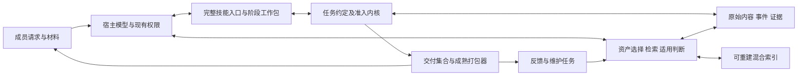

# 整体设计

本文件是本轮目标设计的语义单源，逐项决定在 decisions.json，实施顺序在 execution.md。
设计将行业规范、成熟通用实现与 AstroFairy 的领域规则分开；完整达标以实际接线验收为准。

## 1. 范围、目标与不变量

范围为入口、信息装载、任务执行、问答/修订、多产物、检查交付、资源、检索、学习、存储恢复及分发。
保留宿主现有模型和权限，不建设通用托管智能体、账户系统、远程共享服务或强制宿主工具代理。
原故障轨迹尚缺失，因此“必要信息外置导致漏执行”仍是待实测根因，设计不以它已被证明为前提。

用户目标优先于代理程序省事。轻量体现为稳定职责与低使用负担；必要依赖、读入、问答和验证允许成本。
保留以下不变量：

1. 原话/材料/新指示可追溯，用户明确要求与运行策略不能被自行弱化。
2. 输入、内容、产物、检查、工具观察与模型判断各有身份；模型声明不能提升为工具事实。
3. complete 只针对当前约定和正式交付快照，全部必要检查通过，且无未决问题/执行冲突。
4. 未知写操作不盲重试；核对绑定原尝试和权威观察；迟到事实、历史结果和当前完整性分别表达。
5. 历史内容/事件不可改写，派生视图可重建；任何新索引不得成为权限、采用状态或任务事实的权威。
6. 字节齐全/格式正确与语义质量分开；本地摘要不冒充外部认证或业务真实性证明。

## 2. 职责与替换边界

| 责任 | 直接采用的通用机制 | 必要的项目规则 |
|---|---|---|
| 发现与信息提供 | Agent Skills/宿主原生调用、结构化 JSON 与现有 schema 查询 | 常规信息放置、状态工作包、结束条件 |
| 约定/准入 | JSON Schema、SQLite 事务和序号、既有事件模型 | 哪个动作当前可做、何谓完整交付、失败适用性 |
| 执行/证据 | 现有注册能力与固定工具合同 | 尝试/观察/确认、来源及权限边界 |
| 内容与档案 | SQLite、hashlib、原生 blob 流读写、既有认证文档 | 引用闭包、快照身份、恢复职责 |
| 文件交付 | BagIt RFC8493、bagit-python、原子目录发布 | 选择哪些正式成员、约定/检查与回执绑定 |
| 检索 | LanceDB OSS 的全文/向量/RRF、FastEmbed/ONNX Runtime | 权威头过滤、版本钉选、应用适用性及索引代次 |
| 学习 | 普通任务和资产版本机制 | 触发、范围、支持证据、验证及采用策略 |

不为每种业务任务添加内核状态。工作流、工具适配、案例和偏好在库中增长；这些名称不是要
新增七套独立框架。所有原始事实仍在既有记录体系，主文和工作包不维护第二份协议字段权威。

## 3. 入口与常规信息

采用唯一 `skills/fairy/` 和 `name: fairy`。项目/Python 包/CLI 保持 astrofairy；宿主 UI 默认提示与
安装命令从同一技能身份校验或生成。描述前置 fairy/星灵直接称呼和委托成果的适用条件。
自然语言选择仍属软性。普通目录和插件命名空间分别列出，例如插件保持 `/astrofairy:fairy`；
实际名称以宿主验证为准，不设置第二份转发技能，不擅自覆盖同名第三方技能。

主文直接包含：

- 如何检查/准备运行环境、恢复已开始任务；读取当前请求/材料及必要指示。
- 如何形成可工作的约定、真实任务准则和必要问题；普通可逆默认由 agent 承担。
- 如何读阶段工作包、找资产、制作文件、捕获所有正式成果并提交交付快照。
- 机械检查与语义判断如何完成，失败/修改后如何继续，怎样关闭并返回全部文件及简明依据。
- 一次有效的短任务命令示例、异常时去哪里、每次交付后的反馈/维护决定。

恢复细节、备份运维、工具作者合同和分享管理按明确条件引用。完整正文不以 6500 字节封顶；
遵循标准建议的适中规模，超量触发人工可读设计审查，不能机械把必需步骤推出主文。

阶段工作包包括 `task/revision/seq`、所需约定/材料、当前问题、下一动作、精确命令载荷模板、
完成条件和恢复身份。仅返回当前阶段必要数据，历史细节可免费续读。生成载荷取自解析器/能力
合同，不让模型凭摘要推测字段，不自动代做语义通过。副作用仍走同一个准入边界。

提供一个 CLI 组合操作 `prepare-delivery`：按已明确成员清单捕获内容、发布快照并运行适用机械
检查，逐动作保留既有事件和调用；它是现有原语的适配组合，不是新的业务流程解释器。
组合不是整体原子外部操作；中断返回已提交阶段与尝试身份，next 只接续未完成部分。

首次环境使用 platformdirs 的平台目录规则，仍优先显式 home/环境配置。准备依赖与模型的动作
受宿主现有授权控制，提供进度和明确失败；成员无需指定内部目录、学习命令或提供新 API key。

## 4. 约定与真实质量要求

初始默认准则标记为 provisional；交付前必须由模型基于实际任务完成约定细化，必要时问关键问题。
complete 不接受未完成细化的默认“相关＋非空”充当所有任务的业务要求。程序只验证准则结构、
来源和覆盖映射，不能假称程序已验证准则语义充分。
约定细化可随首次建任务完成，不强制多走一次人工确认或额外独立关卡。可逆、影响有限的
选择由 agent 使用合理默认并简述；只把会实质改变成果且无法从材料确定的关键问题交给成员，
提供简单选项和推荐。不能用默认编造材料事实，也不把 Grill 变成持续访谈的前置负担。

每条准则包含稳定 id、描述、来源、必要性、checker/参数和明确作用域：

- `content`：纯字节/格式检查，可独立于文件名，绑定内容摘要。
- `member`：与一个命名成员相关，绑定路径及完整成员描述。
- `collection`：覆盖完整快照或一组显式成员，默认语义准则使用完整快照。

约定另列必要交付职责（例如主报告、数据、依据说明），通过成员描述映射；缺少必交职责、
靶标未找到或检查空集合均不算通过。适用范围依据原任务，不把所有任务都强制变成同一套附件清单。

交付说明给人呈现成果入口、内容组织理由、关键依据/计算、假设/待定和检查范围；完整回执
另供深入核验。模型的依据解释仍标记来源，不要求泄露内部推理过程，不用长事件流水代替说明。

## 5. 内容、成员与交付快照

内容以摘要标识原始字节；成员以规范相对路径在集合内区分，包含 ref、bytes、media_type、role。
同摘要可以对应两个文件，内容去重与成员区分各自成立。产物观察保留完整描述，不能再用
`dict[content_ref]` 代替成员目录。发布接收完整的成员清单而非单一 ref。

快照是成员描述按规范路径排序后的不可变对象，具有版本化类型标记和摘要；顺序调整不生成
虚假内容修订。采用现有确定 JSON 编码并明确其格式版本，不冒称已符合 RFC8785/JCS。
`role` 等影响验收的字段参与快照身份；展示性说明与事实型元数据分别标明，不能暗改受检对象。

相对路径使用正斜线和 NFC；非规范输入明确返回更正建议，避免静默改名。使用成熟 pathvalidate
加目标平台规则验证，拒绝绝对/父级路径、符号链接逃逸、重复路径、文件目录冲突及跨平台
无法区分的名称。可移植性约束须声明，不能把 Linux 上能创建文件当作跨平台证明。

整份清单提交时校验所有成员均为任务有权使用的已观察输出或明确定义的候选种子，内容存在且
完整；数据库事务中绑定 expected_seq。随后工作区变化不能修改已捕获快照。

## 6. 检查身份、变化与失败

检查身份至少包含任务约定 revision、准则定义指纹、checker 的固定定义/参数、作用域及靶标身份。
机械结果关联实际调用及 checked witness；模型判断保留 basis/evidence/producer。

采用保守规则：任务约定实质改变时所有受影响检查重做；新快照不继承集合级通过。只有声明为
纯内容且实际工具支持的机械检查，才能在准则、工具合同、参数、内容和约定身份一致时复用
已记录观察；pass/fail/unknown 同等处理。普通语义判断不自动做增量复用。

同一靶标的失败不能被重新发布、改名或新增无关文件清除。任何 content/member/collection 靶标变化后，对同约定同
准则的未被合法替代失败都必须显式处置，列出前序事件、当前靶标与修改依据；next 从记录生成待处理失败 id，
避免 agent 自行检索流水。成员 path/role/media 变更同样不能逃过关联；单改 subject id 不解除待处理集合。
合法新检查可形成有依据替代：机械失败须有确切当前靶标的新实际检查，模型口述不能替代工具通过；
语义重评保留判断来源和依据。旧记录永久保留。不能因新快照暂时
没有活跃判断就得到通过，也不能把旧集合失败无限套到已经修复的新内容上而不允许重评。

迟到矛盾按当前执行完整性处理，历史 outcome 不覆盖；新快照/新回执不销毁已有事实。
候选采用要求固定策略明确检查确切候选内容及其适用性；候选只出现在集合中不足以采用。

## 7. 标准交付与恢复

默认交付采用 BagIt 目录：`data/` 放所有正式成员；根目录放 bagit.txt、SHA256 payload manifest、
tag manifest、receipt.json 和简明说明。让 bagit-python 实际生成/完整校验；AstroFairy 只组织已授权
成员、固定回执与快照关系。禁用 fetch/远程取回，交付不通过可变 URL 冒充已捕获原件。

先在独立私有临时目录构建，完整验证成功后同文件系统发布到新的快照/事件序号目录；已有目录
核验后幂等返回，不覆盖为混合状态。不用 fast 校验替代字节完整校验。默认给用户所有实际文件
链接及回执/说明；单文件同样有直接文件链接，不要求用户理解包格式或先解压才能工作。

清单只包含正式选中成员，不循环导出全部历史稿。回执含快照身份、约定 revision、记录 seq、
每条要求/检查靶标/实际来源和当前未决项。晚到事实生成新的回执目录，不污染旧快照发布物。
optional ZIP 只是同目录的标准压缩视图，由标准库处理；用户有此需要时提供。

原始成员、快照、准则、检查证据与候选绑定全部纳入审计引用闭包。备份继续使用 SQLite 原生
主库先、文档库后方案，准确说明文档超集而非跨库原子时间戳。所有历史快照均可从捕获内容重建。
检索索引是可重建缓存，模型/分词配置和身份清单须保留；恢复后不就绪明确说明，不能静默返回无资产。

## 8. 资源政策

移除问答终身 3 次硬限，保留一个明确待答对象与必要性/疲劳策略；澄清、变更和修复可继续。
移除 6500 字节及 1500 行提交硬门，保留规模统计、职责/重复/可读性审查和明显增长理由。
默认不再以 16 次注册调用作为完成额度。设置宽裕的工作预警与最终防失控计数，重复且无新信息/产出的动作由既有重复防护拒绝，
未决写入必须先核对；agent 不应等待耗尽最终计数才停止无进展循环。实际成本优先
采用宿主可取得的 token/费用/时间；不可取得的值标记 unknown，不推算伪账单。

采用一个有类型、只读加载的资源配置单源，各字段有单位/范围/消费者；部署或任务授权可显式
收紧，agent 不能为绕过最终边界自行无限续额。有效配置指纹进入任务，调整留痕并受既有授权范围
约束。权限、证据和安全不变量从资源设置中分离，资源放宽不授予新的写权限。

工程初值及其理由登记于 decisions.json：它们是可校准的实现输入，不冒充行业规定或已测 SLA。
正式采用前 W05 必须测 normal/worst-case、总调用与内存，符合验收后冻结到配置；若须改变记录
测量及理由，不把实施校准变成再一次架构重设计。

文件采用流式捕获/哈希/导出，使用 SQLite blobopen/zeroblob 和私有临时文件；大文件额度与
命令 JSON、文本字段、工具合同、回包、读取片段分别管理。小回包只是传输选择，不限制真实
材料总量。正常上下文读取和目录查找不计工作调用，仍有每响应和运行资源保护。

保留文档分块、认证及免费选择读取，避免为了扩大回包推翻已验证存储保证；内部块/扇出/
缓存参数保持当前值，仅在独立性能证据支持时调整。主/文档库锁、备份复制和整体截止分开。
运行器无法安全强杀任意可信同进程 handler，实际 timeout/cancel 由具体适配器及宿主管理；
其能力与未知写入状态如实声明，不宣称最终调用数已控制一次调用的全部资源。

## 9. 混合检索与资产读取

默认技术路线选择 LanceDB OSS 本地索引，使用其 BM25 全文、向量查询和 RRF 融合；跨语种
全文先使用带内置数据的 ICU 分词，关闭不适合混合语言的英语停用词/词干化。模型型 Jieba
需要额外字典，不作为无说明的隐含依赖。纯 SQLite FTS5 继续作对照，不作默认语义能力替身。

嵌入使用 FastEmbed/ONNX Runtime 的成熟本地组件；默认模型必须有明确多语言/检索能力、
可接受许可、公开原件、固定 revision/文件 SHA256、CPU 可用及有限实测支持。具体模型见
research.md 的版本/探针结论；不以任意相似度向量或英语模型冒充中文语义检索。
不新增业务模型账户/API key，不向远端发送资产。下载/准备是显式、可观察的安装工作；模型缓存按固定原件只准备一次，普通任务复用，不在每次请求重新下载。
库为空不下载/启动模型；首次方法维护时可准备后续检索前提，并保留可接续状态。存在资产而模型缺失时返回 search_not_ready 与接续方法，禁止
把静默字面降级标作完整检索，也不妨碍有明确边界的任务部分交付。

索引字段覆盖名称/摘要/标签、适用条件、依赖、工作流输入/步骤/完成条件及正文。按结构单元
切分，长单元按模型实际 tokenizer 预算拆分，每块保留原资产 ref、字段/步骤定位和覆盖跨度。
采用成熟 tokenizer，不自写中文字典；索引前检查没有静默截断，固定查询/文档前缀和归一化策略。

查询保留原文，受控生成关键词/语义查询；先得到较宽候选，再融合、按资产聚合去重、形成
短名单和命中片段。RRF 是排名融合，不冒充神经重排；最后由宿主读取适用条件和必要步骤，
明确采用/改编/拒用理由。只有片段相关不能自动执行方法。目录和内容有游标及免费分页，
不再静默丢弃第 17 个词，不要求成员写检索式。

事实来源为 SQLite 资产事件/包。以现有全局资产事件序号作可重放更新日志，索引记录 source_generation
及模型/分词/字段/切分 profile；采用/修订/退役事件提交后同步投影，失败留 pending。查询前
要求投影达到当前所需代次；短 SQLite 读事务冻结所需代次及权威可用头后即释放，
不跨模型推理/索引搜索持事务。查询绑定对应 LanceDB 固定版本并作精确资产键过滤；读取/采用前再核权威状态。
索引落后/损坏时显式重建或返回未就绪，不把缺失的新资产隐藏在成功空结果中。

状态/范围/类型过滤优先于排序，候选和退役不进入新任务普通发现。当前任务已钉版本可按历史
授权读，不能把退役解释为全局撤销。索引写入已完成但 watermark 未记时，按内容/profile 键
幂等重放；generation 不一致不能取得“最新完整搜索”结论。

必需流程及约束不依赖 top-k。当前任务必需规则由明确范围和已采用治理资产确定，并随约定
固定引用；未知适用性显式提示宿主判断，不能因相似度低静默跳过。个人偏好与团队 namespace
仍不是账户 ACL，资产不得自行提升宿主权限。

## 10. 学习与成熟工作流

每次交付工作包提供一个简短的学习决定：有依据维护、暂缓或无需改变。真实反馈、新指示、
成功的方法和重复结构进入信号；保持交付优先，不强制每次创建完整维护任务，也不后台无限运行。
维护事项用普通任务承接，记录 source task/seq/快照，后续会话可发现待处理事项，无需成员记编号。

资产增加结构化适用范围、输入/依赖、证据案例及失效条件；完整内容留在包中，索引只是投影。
固定事实、个人偏好、约束和方法职责不同。验证至少覆盖声明适用的正常路径及边界/不适用反例，
有纠正时覆盖修订；成熟度根据适用范围、实测结果和净成本判断，不凭固定使用次数自动晋升。
候选检查/采用仍固定到确切内容和策略。允许合并、修订、退役、回退新候选和不变，避免重复累积。

分享使用版本化 JSON 资产包与清理后的声明性 provenance，不默认传整个任务原件；接收端本地
验证后才采用。已有 bundle 不作兼容回退；团队账户/远程同步留在明确的未来产品范围外。

## 11. 生命周期、分发和质量控制

主协议/库格式升为新开发版本，所有旧格式在写入前拒绝；保留旧数据和历史基准，选择新 home，
不提供迁移脚本、旧命令别名或双投影代码。新协议语义由一处字段/Schema 定义生成查询和例子。

核心依赖、检索依赖、模型原件与分发元数据分别锁定并机器校验。bagit 若仅有官方 sdist，
由隔离、固定构建链生成标准 wheel 并保存原件/构建/输出哈希，不让普通成员临时编译或改用自制打包器。
检索组件按需延迟加载，首次准备有进度；支持矩阵按实际 wheel/原生任务结果声明，缺平台不伪装。

保留类型、风格、真实测试收集、同源包和文档检查；新增主文及工作包行为评测、完整产物校验、
资源剖面与检索/学习净收益验证。运行器程序通过不等于模型已读资料或团队效果已优秀。
实施以 execution.md 的有限门收敛，长期真人收益作为发布后的持续反馈，不能让本轮无限延期。

## 12. 关键输入、输出与恢复合同

下表规定目标语义；具体字段在 W01 的单源 Schema 生成，不在本文再维护第二套 JSON Schema。

| 责任主体 | 输入与前置 | 确定输出/提交点 | 拒绝与恢复 | 验收 |
|---|---|---|---|---|
| 完整入口/阶段包 | 真实请求/材料、宿主权限、task/revision/seq | 建立或续接同一任务；准则/阶段/载荷模板引用同源字段 | 就绪未完成返回准确准备步骤；过期 seq 重读 next，不猜旧状态 | V01–V05 |
| 约定准入 | 原要求与来源、必要交付职责、准则及其 scope | revision 与固定准则定义，provisional 经模型真实细化 | 不全不能 complete；新增要求走修订，真实语义不足不能用程序结构通过遮蔽 | V04,V08,V09 |
| 捕获/快照 | 已授权真实输出、相对路径/role、expected_seq | 流式内容及观察；单事务发布完整描述集合的快照 id | 超额/路径冲突明确拒绝；捕获未提交私有暂存可清，已提交内容可复用 | V06,V07,V13,V14,V22 |
| 检查/采用 | 固定准则/checker/参数、精确 subject、真实尝试/观察 | 机械见证或模型判断；明确替代链；候选对应固定策略结果 | 靶标空缺不通过；失败重评关联前序 id；未知工具效果走原尝试核对 | V08–V12,V23 |
| 导出/回执 | 固定快照、约定及 seq、全体内容闭包 | 成熟 BagIt 全校验后原子发布新目录，成员和说明直接链接 | 中断暂存不算成功；已有目录重核幂等返回；迟到事实发布新 seq 版本 | V13–V15,V23 |
| 搜索投影 | source_generation、资产包/权威头、固定完整 profile | 固定 LanceDB 版本与投影指针，搜索返回代次/profile/确切资产键 | 未就绪不能假装空结果；按事件幂等同步/重建；使用前重核头与适用性 | V16–V19 |
| 学习维护 | 实际信号、source task/seq/快照、适用范围和来源 | 维护/暂缓/不变；验证后的候选/采用/退役状态事件 | 无足够依据不晋升；正文/案例可按需访问，失败不反写技能核心 | V20,V21 |
| 恢复/分发 | 受检原件/锁、原生备份、捕获引用闭包 | 新 home 上可审计主/文档记录，派生检索明确准备后使用 | 旧格式写前拒绝且不改旧数据；外部状态/未知效果不能伪恢复 | V02,V23,V24 |

### 12.1 索引的一致视图与并发

直接使用 LanceDB 的版本查询/`checkout(version)`（DS17 和固定安装包实际 API），
不用搜索期间不断变化的 latest 表。以成熟 `filelock`（DS16）在同一应用 home 串行“取源代次→投影→指针提交”全过程，
仅接受经验证的原生内核锁后端；无法取得则显式未就绪，不接受自动软锁回退。
原生锁在进程退出时由系统释放；不自制带过期猜测的租约。该锁不替代主库事务或宿主权限。

一次投影读取主库已提交资产事件至 G，按内容/profile/块身份幂等更新，完成全文索引后取得
LanceDB 表版本 V，最后在主库派生元数据事务记录 `(projection_epoch, G, profile, V)`。索引写成功而指针失败
可以从旧水位重放；禁止先更新水位再提交索引。一次查询在主库同一短读快照内取得 G/可用头集合/派生指针；只接受指针 G **恰等于** G、
epoch/profile 一致的版本。不同则释放事务，同步后从头重取三者，有限重试后 not_ready，
不把 G 的头配到 G+1 的表。取得匹配指针后释放事务，以独立 table handle checkout 已记录版本；不改共享 handle，
不调用 restore 改写最新表。过滤使用完整资产 ref/内容键，不只使用可变名称或 namespace。

投影期间有新事件则该次结果声明自己的 G，使用前再核真实当前头；若要求最新完整搜索而 G
已变化，重新取快照并有限重试，持续变化时显式返回可接续状态，不无限追最新。
恢复主库时一律废弃旧指针并生成新的本地 projection_epoch，索引 not_ready 后重新投影。
不得仅因序号相同就复用其他 home 或恢复基准的缓存；epoch 不改变历史任务/事件身份。
若指针绑定版本已不存在，必须重建，不能换 latest 冒充同一代次。首版不自动清除仍可能被查询
使用的表版本；缓存容量不足显式诊断。后续自动清理必须有在用版本保护和可重建验证。

### 12.2 延迟与资源的可验性

完整首用安装、一次模型准备、热查询和实际内容生产分别计时。首反馈必须是用户可见的有效
行动/进度，不用后台开始时间充当已响应；大模型下载不得成为每次任务的常规等待。
W05 在明确机器和代表性库上封存冷/热延迟、内存/磁盘及策略默认；W06 以同机同任务旧实现
作对照，对明显退化解释并修复。业务生成时长无通用固定秒数，不能制造跨任务 SLA。
默认模型需同时通过语义与可用性门；只有更小而未达质量的型号不能因省资源获得豁免。
