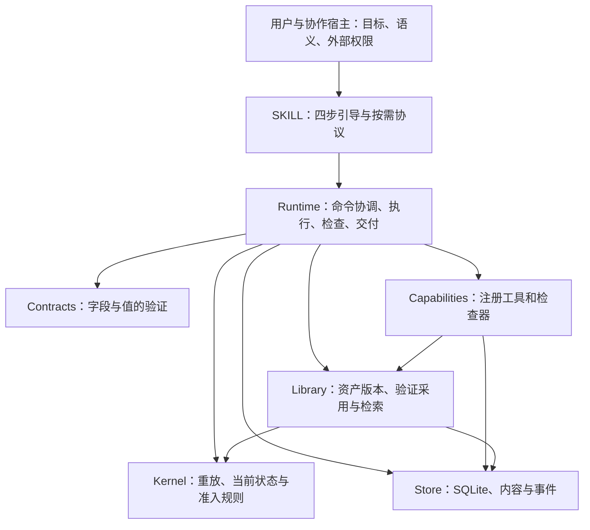

# R02：核心架构与成熟方案比较

日期：2026-10-28。状态：主审及独立复验取证完成，两项概念边界候选未闭合，不宣称架构收敛。
产品基准：`22b7ece5d8388379f7b4bcaf47de4c047173cd9b`。
本记录审查职责与取舍，不修改生产机制。任务范围见[R02 任务书](R02-brief.md)。

## 当前可以成立的判断

协作宿主负责语义，本地运行器负责协议、当前版本检查和持久记录，经验在外置资产增长：
这条方向有明确职责依据，也有本轮零核心改动扩展的机械证据。
**不能据此断言现有实现已经最简、永久充分，或全部达到行业地板。**

底层事务已经复用 SQLite。成熟框架仍是合理候选；本轮没有取得“必须整体替换为某框架”的证据，
也没有取得“自有运行器已经优于这些框架”的证据。暂保留现架构作为待验方案，
通用机制的保留、复用、简化或替换继续受逐对象对标约束。

两项需要明确处置的架构边界已暴露：未决工具调用没有公开核对结案通道；工作包会重复携带全量用户修订。
前者已有保守停止策略，后者尚无总包预算/增量读取契约。它们不证明错误交付或数据丢失，
但不能在恢复和长期成本的结论里省略。分类、独立意见与移交见后文。

## 基准、方法、角色与取证边界

本轮再次将 51 个冻结文件逐一与 Git blob 比对，均一致。生产 Python 共 12 个文件、1,580 行，
其中四个预算内文件共 978 行；数字来自冻结文件逐行计数，不是复杂度或质量评分。
准备包和本轮报告属于工作树材料，均不混入冻结产品。

主审为当前会话执行主体；独立复验为新上下文主体 `r02_independent_review`；最终裁决为用户。
采用 FDP 支线 B 的方法内验证特化。原件全文及 changelog 顶部已重新装载，v1.0.3 身份未变：

| 原件 | SHA256 |
|---|---|
| 正文 | `0eefcd7c35cf57bcf1db219c5e8d3fad708c863ffd4708cd0c5234bd7151caf4` |
| 载体 | `8138c90436a9bd5c30141df7e269409c083af050e6052f43a5f0be7b4a904922` |
| 复核协议 | `d805efae4ea778bb50872125cf695dca819906c1d64db4d50d61fe1fc84d2871` |

FDP 是工作方法，不能代替行业来源。严重度 BLOCKER/CRITICAL/MAJOR/MINOR/NOTE 与处置优先级 P0–P3 分开使用。
本项目沿用已说明的本地归档适配；没有把母项目的 Issue 地址或发布流程带入本仓。

比较前提：用户通过现有会话宿主工作，宿主已有模型、工具权限和命令/文件能力；运行器可用持久本地目录。
不把“无第三方运行时依赖”当作不可改变的用户要求，不假定必须自建模型循环或部署服务。
涉及敌对宿主、原生应用发现、真人质量、真实时延与长期增长的结论仍需相应方面取证。

## 从任务需要推导职责

用户需要的是可用成果及可理解的依据，同时减少组织负担。由此至少要回答下列问题。
这些是职责位置，不要求一项一个文件，也不要求产品只能有四个模块。

| 需要回答的问题 | 权威与输入 | 当前负责位置 / 产物 | 删除或混淆会发生什么 |
|---|---|---|---|
| 到底做什么、哪些取舍由谁决定 | 用户范围；宿主调查事实并形成派生假设 | SKILL:9/17，host:11–17；spec、criteria、answer/revise | 没有可对照目标；或把可推导工作转回用户 |
| 哪个动作现在可以开始 | 当前任务、效果范围、预算、未决状态 | `_kernel.py:99`；`_runtime.py:133/271/402` | 顺序、范围与重复风险改由各调用者自行维护 |
| 动作实际发生了什么 | 宿主报告或注册处理器观测，来源有区别 | `_runtime.py:110/133/296`；invoked/observed | 只保留最终文本就无法区分意图、执行和观测；启动与效果混为一事会丢失中断窗口 |
| 对哪个版本、按什么准则检查 | 准则、成果序号、任务修订、证据 | `_kernel.py:30/117`；`_runtime.py:197/221` | 旧成果的 pass 可能被用于新成果；动作成功可能被误当质量通过 |
| 哪些原件和过程可重建 | 内容字节与事件 | `_store.py:62/78/97`，`_kernel.py:63` | 仅保存当前状态无法还原修改和检查依据；仅保存日志而无字节无法复查原成果 |
| 什么时候停、交付什么 | 当前检查、未决事项、成果 | `_kernel.py:146`；`_runtime.py:390/477` | 容易把可用、完整、取消混在一起，或有记录无可取得成果 |
| 下次如何更好且不增加常驻负担 | 已完成任务、真实反馈、候选证据 | `_runtime.py:500/512`，`_library.py` | 学习若写回常驻入口则增加全局负担；候选若直接生效则把一次经验当普遍规则 |

授权不是由附件或资产创造：宿主仍控制外部行动，运行器只管自己的 effects/协议。
真实 token/耗时由宿主管理，调用与内容限额属于运行器。这些是前提，不是新的隐藏产品服务。
外置资产可缺省，普通任务并不要求先建立或采用工作流。

### 职责、数据与依赖

图展示主要源码依赖；省略共有基础验证和仅类型导入，不表示权限沙箱。
Store 唯一承接连接和事件追加，Library 拥有资产查询/状态语义并直接使用连接；
Runtime 协调跨对象规则，Kernel 并不包含所有命令分支的校验。例如显式要求修订保护在 `_runtime.py:322`，
资产采用保护在 `_library.py:137`。因此，“所有规则集中一个文件”不是当前结构，也不是正交性要求。

当前所有权可追踪，但存储与资产 SQL 不是任意后端可直接替换的抽象；
注册处理器获得 Store/State 是受信代码扩展，不能把扩展称为隔离插件。

### 删除与合并推演

以下是结构反事实分析，不冒充执行过改写版程序的消融试验。

| 对象 | 更小方案 | 消失的能力或转移的复杂度 | 本轮处置依据 |
|---|---|---|---|
| 状态判定 | 宿主靠指令记住完成条件 | 修订、旧检查、未决调用要靠每次推理维护 | 有确定规则价值；不证明必须采用当前函数/字段组织 |
| 事务存储 | 单 JSON 文件覆盖写 | 多动作一致性、并发比较和故障窗口要另写锁/恢复 | 已复用 SQLite 更合理；具体事务失败行为待 R04/R14 |
| 事件重放 | 当前状态表加独立审计日志 | 状态与日志需双写一致性；但读取可能更简单 | 两者均合理；本轮未做等保证成本对照，不能只以可审计为由排除快照/CRUD+日志 |
| 内容寻址 | 普通文件名覆盖 | 检查和采用要另保证原件不可变、版本唯一 | 原字节和精确版本有必要；不必因此使用完整 Git 仓库 |
| 事件哈希链 | 顺序事件而无链 | 少一层本地改动检测；事务和序号仍可存在 | 属附加保证，非任务推进的逻辑必要条件；有开销但没有外部见证，最终取舍待 R14/R07 |
| 调用包装 | 直接调用处理器，仅记录返回 | 效果已发生却没记结果时，无法看到启动记录 | 启动/观测分离有价值；同任务核对收口见 D01 |
| 校验、准入与执行合并 | 一个大 dispatcher | 可以减少接口，但容易将值校验、状态和效果混合 | 保留语义边界；未证明现有四文件是唯一最小划分 |
| 资产维护 | 每次任务追加入口规则 | 经验污染常驻指令；版本与适用性不受控 | 外置且可修订/退役方向成立；成熟度、检索与收益待 R08–R10 |

## 成熟方案比较

比较的是相同职责和前提下能提供什么保证。没有安装或运行下列框架，不报告其性能、真实集成成本或故障恢复实测。
候选的 README 自述只用于发现能力，实质判断另依赖本轮读取的接口/实现片段及官方原文。

| 候选 | 已核验的职责与实现 | 与当前需求的关系 | 当前不能据此决定什么 |
|---|---|---|---|
| 宿主原生执行 | 当前会话已有命令、文件和模型；各宿主保证不同 | 能直接组织任务；若原生保证足够，可减少重复机制 | 未做五种宿主契约审查，不能假定原生已提供修订绑定、资产验证和持久回执；R12 |
| 纯指令、文件夹/清单 | 无本地状态门，依赖宿主遵守流程 | 可以更轻；仍应参加同任务对照 | 未测是否同样可靠且更快，不能先排除或宣布胜出；R03/R07 |
| SQLite 标准库组合 | S13 明确事务和 IMMEDIATE 的写锁语义；本项目使用 sqlite3 | 事务引擎已复用成熟实现；自写的是领域表、规则和投影 | 不等于全部错误/并发/权限情况已达标；R04/R14 |
| 当前状态表/日志与事件源 | S25 描述重建、并发、演化、重放成本及选择性采用 | 当前历史责任适合考虑事件；但事件源不是所有数据的必选 | 没有等保证实现成本实测，不能证明当前全重放更省；R07/R10 |
| Git 对象库 | S31 官方书示例确认内容寻址、版本字节的取回 | 是成熟内容版本机制候选；当前只需 blob 摘要和领域事件 | 不必因原理相同而自建完整 VCS；也未评估用 Git 后端的锁、清理和集成成本 |
| XState | S37 的 StateMachine 配置、guards/actions/actors，以及 transition 调用 macrostep | 成熟通用状态机候选，可为图/动作模型提供能力 | 它不会自动定义本项目的版本检查、证据、资产政策；需 JS/TS 适配。当前未证明这项适配值得或不值得 |
| JSON Schema / Pydantic | S19 assertions；S20 字段验证及错误；可作为结构契约实现候选 | 有助于减少手写类型验证和提供可读契约 | 当前 `schema` 是字段目录，不能冒称标准 JSON Schema。类型/消费者/依赖成本需 R06/R11 继续，不以无依赖偏好直接排除 |
| OpenAI Agents SDK | S48 Runner.run 驱动 Agent 循环；Session 接口及 SQLiteSession 储存会话消息 | 整体 runner 与现有宿主模型循环有重叠；单取 session 不会自动成为当前领域事件/检查账 | Session 可独立使用，不将额外 API key 当作其必需条件；需评估桥接与缺失领域规则，不据品牌整体替换 |
| LangGraph | S43 提供线程检查点与跨线程 Store；tick/after_tick/_put_checkpoint 实现推进和保存顺序，interrupt 有恢复输入 | 可提供成熟恢复和持久执行；也可把宿主工作作为节点组合，不局限自建 LLM | 需适配外部宿主、领域检查与存储。已读恢复文档强调重跑和幂等，不能据框架名称推定任意副作用恰好一次 |
| Temporal SDK | S44 示例要求 Client、Worker、任务队列和 Server；支持工作流/活动分工 | 适用于更强的持久编排需求；部署与当前单目录使用模式有差异 | 没有 Server/Worker 实测，也没有排除未来组合；目前没有证据要求普通成员承担该部署前提 |

本轮建议是继续检验已有薄运行器的净收益，同时优先使用成熟底层，避免另造通用图引擎、数据库或模型循环。
这属于下一步调查选择，不是架构定案。若后续出现能满足关键保证且成本更小的成熟组合，应回判当前选择。

## 结构与替换探针

主审在 `.evaluation/reviews/R02/` 运行 Python `-I -S -B` 探针，显式仅加载冻结脚本。
素材、数据库、生成文件与扩展适配均位于隔离目录；运行前后生产 Python 摘要一致。

| 探针 | 实际观察 | 证据不能支持的扩张 |
|---|---|---|
| 新 CSV 计数任务 | 新注册 `data.total` 读取捕获输入，产生 JSON；事先固定结果 5，机械检查后完整交付 | 不代表所有任务类型均可覆盖 |
| 新机械检查器 | 替换 `content.check` 的适配层，新增 `csv-total` 并保留原检查器；Kernel 无改动 | 不证明任意新检查器都可信或已被安全隔离 |
| 新外置工作流 | propose→验证任务→trial→新任务读取并绑定版本，核心无改动 | asset-fitness 的 pass 是明确合成夹具，不作为真实收益或成熟证明 |
| 替换资产策略的边界 | 只替换 `Workshop.library` 不会改变内置 `asset.search`，因为后者重新构造 Library | 这不是单参数全后端替换接口；应同时适配工具路径，不能误写为绝对不可替换 |
| 工具效果之后异常 | marker 实际存在；调用为 unknown；捕获成果并通过必要检查后，完整关闭仍为 not_ready；可部分交付 | 不证明错误宣告完成；确认的是核对收口通道缺失 |

独立复验另做了工具/检查器、工作流、资产检索策略、CLI 进程适配、未决调用及工作包增长探针，结果见独立意见节。
CLI 进程适配证明传输层可换，不冒充原生应用兼容。现成资产库缺省也不会阻止任务开始。

### 四步入口与 16 类范围

Define 对应 start/answer/revise；Produce 对应 request/report/invoke/publish；Check 对应 check/review；
Deliver 对应 close/deliver。修订与修复可以回边，四步是交互解释，不是只允许向前的四值状态机。
维护在交付后新建普通任务，任务结束不要求用户先完成第五阶段学习。

| 场景类别 | 责任可落位 / 本轮限制 |
|---|---|
| S01–S05 普通任务、关键选择、矛盾材料、开放工作、计算 | 宿主设目标与调查；准则/来源在账；S05 有合成计算证据，其他尚无本轮语义实测 |
| S06 二进制、多件成果及渲染缺失 | capture 保留字节，主成果可打包；多件清晰交付与渲染依赖宿主，R05/R12 继续 |
| S07–S09 改变要求、预算/中断、并发/迟到 | 修订、当前检查、未决状态及追加记录有落点；D01 是未决工具调用的边界；未完成全恢复验收 |
| S10–S13 反馈、重复、增长、分享 | 维护/候选/采用/版本/导入有落点；效果、检索与规模待 R08–R10/R14；D02 涉及历史传输 |
| S14–S16 新环境、损坏/大文件、替换与越界 | 数据与安装目录分离，显式错误与能力适配；本轮只有隔离进程与扩展的机械证据，不能穷尽宿主和故障 |

## R02-01–09 逐项意见

| 检查项 | 结论及范围 | 证据 / 尚缺义务 |
|---|---|---|
| R02-01 基本问题与前提 | **通过，限职责推导** | 从目标、行动、观测、判断、交付、反馈重新推导；宿主、权限与持久化前提显式 |
| R02-02 必要性 | **通过，限职责必要性；具体实现最小性待证** | 删除/合并推演有能力损失或责任转移；哈希链、全重放及文件划分不被当作必然选择 |
| R02-03 分工与边界 | **通过，限当前所有权可定位** | 图、源码和政策位置可追踪；SQL/Library 与受信处理器耦合已披露，不声称任意后端可插拔 |
| R02-04 声明范围覆盖 | **待证** | 16 类有责任落点；D01 的核对收口、真实语义及异常组合尚未闭合 |
| R02-05 核心/策略分离 | **通过，限合成演练** | 新任务、新工具/检查器、外置工作流零核心变更；未来任意任务仍非已证 |
| R02-06 四步一致性 | **通过，限协议和控制流映射** | 四步均有落点，可回边；学习不成为交付前提；真人体验仍待 R03 |
| R02-07 复杂度值得 | **待证** | 成熟/更小候选、获得的保证与成本已拆开；缺等保证同任务对照、长期重放和总包成本，关联 D02 |
| R02-08 可替换性 | **待证，有局部机械支持** | 工具、检查器、策略适配、CLI 传输可换；未证明整个存储后端或原生宿主无缝替换 |
| R02-09 保证范围诚实 | **待证，需吸收已发现边界** | 冻结文档总体披露协作/语义/资源限制；D01 不能仅表述为“没有自动恢复”，D02 不能被单字段/调用预算遮盖 |

通过项不包含行业对象的完整通过，也不替代对应运行/效果方面的验收。

## 逐对象 Q01–Q08

每个对象完整保留八项责任；“部分”均表示还不能裁定达到/超过适用地板。引用本报告前文不重复抄写同一来源。

| 对象 | Q01 职责/前提 | Q02 权威依据 | Q03 合理备选 | Q04 差异/地板 | Q05 本轮证成 | Q06 组合 | Q07 复查 | Q08 当前处置 |
|---|---|---|---|---|---|---|---|---|
| A02 宿主/运行器 | 语义与本地状态分工，宿主协作 | S01/S43/S48 | 原生、纯指令、SDK/图节点组合 | 不能借框架名取得宿主权限或真实质量 | 代码无 provider SDK；隔离 CLI 协议可用；部分 | 原生加载与外部行动待 R12/R14 | 防止把传输替换当原生兼容 | 暂保留待验；不定案整体重写 |
| A03 协议/判定/执行/存储 | 值、状态、效果、记录职责；Runtime 组合 | S12/S19/S20/S37 | 合并 dispatcher、结构校验库、通用状态机 | 现有字段目录弱于完整类型 schema；并非声称该标准 | 全文定位分工；未做验证库成本对照 | Library SQL 与 Store 耦合可见 | 不把文件数当正交证明 | 边界保留；校验实现待 R06/R11 |
| A04 任务循环/完成 | 当前检查和无未决才 complete | S12/S37/S43 | 原生、显式 guards、持久图 | 安全拒绝有支持；核对收口不同，D01 | 完整关闭门和扩展探针；未证明语义 | D01 影响异常退出与继续 | 未决不被误当自动重试缺陷 | 记录 D01，R04 明确处置 |
| A05 原件/事件/投影 | 原字节、重建与版本证据 | S13/S25/S31 | 状态+日志、快照、Git 对象后端 | 事务成熟；全重放与本地哈希仍有成本/限制 | Store/Kernel 全读；旧版本身份冻结 | 导出是投影；附加故障与跨对象一致性待审 | 不把哈希当外部认证 | 暂保留；R04/R07/R10/R14 对照 |
| A06 外置资产/维护 | 经普通任务验证候选，策略外置 | S43/S48，S03 后续深入 | 文件库、跨线程 Store、版本资产 | 图 Store 不自动提供适用性/采用政策 | 新工作流验证/读取合成链路 | 检索策略替换须协调 CLI 与能力路径 | 合成 pass 不充当学习成功 | 暂保留；R08/R09 核验收益与成熟 |
| A07 共享分发源 | skill 与可选 wheel/ZIP 同源 | S01，宿主规范后续取证 | 标准目录、可选宿主适配、独立服务 | self-contained 有架构基础；宿主行为另测 | pyproject/打包器指向同一源；未重建分发物 | 持久数据独立于安装；更新待 R12 | 静态同源不等于安装/更新验收 | 保留共享源方向；R11/R12 完整审 |
| A08 核心与外围增长 | 策略/经验外置、核心预算 | S25/S43；S03/S39 待后续深入 | 任务化资产、摘要/索引、快照/增量 | 入口不增厚不代表工作包不增长，D02 | 新任务零改动有支持；未来增长无证明 | user_updates 进入 next，重放也有增长 | 不据行数预算宣称未来完备 | D02 移交 R07/R10；持续演练 |
| A09 整体保证 | 目标到交付、维护的组合 | S01/S13/S25/S43/S48 | 更小同保证组合与框架组合 | 组件成熟不等于组合成熟 | 主链可机械完成；效果和行业全链待证 | D01/D02 是组合边界；权限另审 | 逐场景残类显式，不假称穷尽 | 不作整体通过，保持可替换 |
| M10 能力目录/注册 | 发现工具、字段和效果，注册处理器执行 | S01/S43/S48；类型契约另见 S19/S20 | 宿主工具目录、SDK 工具适配、当前注册表 | 当前有限目录非标准完整工具 schema | 注册新工具/检查器成功；有参数名无类型目录 | 受信扩展可访问 Store；不隔离 | 目录可用不证明语义选择正确 | R06 比较发现/契约成本，不先改机制 |
| C07 增长与替换 | 扩展成本和上下文长期控制 | S25/S43 | 工具适配、原生宿主、快照/增量 | 传输/策略局部可换；存储/历史规模待证 | 两组独立合成替换；D02 定量证据 | 新能力不改核心；任意后端非已证 | 防止把一次演练推成永久稳定 | R07/R10/R12 续证；无最终对象裁决 |

来源列中的后续候选没有被计为本轮已经完整读取。所有对象的最终 `decision` 仍未裁定。

## 已确认边界与真实性复查

下面记录可重现事实、影响与待处置责任。它们不等于宣称出现严重产品事故；
范围是否收窄、协议是否补足或机制是否替换，需要后续明确判断。

### D01：未决工具调用缺少公开核对结案入口

- 类型：架构能力边界；如果补足需改变协议/状态语义，属概念级处置。主审暂记 **NOTE/P2**；
  独立复验建议在保留同任务核对后继续的承诺时定为 **MAJOR/P1**，条件及协调记录见下文。不是两个独立发现。
- 位置：`_contracts.py:18–31`；`_runtime.py:166–195`、`:296–310`、`:412`；`_kernel.py:51–57`、`:99–109`；`references/review.md:9–11`。
- 触发：注册 write 工具已产生局部效果，随后异常或中断，启动记录存在但结果为 unknown/pending。
- 实际：主审核实 marker 存在，再捕获、检查成果；全部准则通过仍无法完整关闭。report 不接受 tool call，重复调用被拒绝，next 仍要求 resolve_pending。
- 预期边界：安全拒绝完整关闭是正确的；若产品要求核对后在同一任务恢复，必须存在带证据的收口动作。当前没有该动作。
- 第二起点：从全部公开命令枚举和状态重放检查入口，再由独立主体在重开数据库后重现 unknown 与 pending 两条路径，排除只是一次异常回包。
- 可证伪预测：通过现有公开接口核实实际效果后，原工具调用仍不能由 pending/unknown 结案。若存在无需改写数据库/代码且保留来源的入口，本条应撤回或收窄。
- 严重度依据：没有虚假 complete；partial/failed/cancelled 仍可诚实退出。冻结指南已披露不自动核对，但“不能自动核对”不足以说明“也没有手工核对落账入口”。
  不据此宣布整体不可用，也不把任意外部副作用自动恢复升格为初版硬要求。
- 去向：R04/R14 明确同任务核对、转部分/失败并启动后续任务之间的契约和证据继承；R16 校准用户可见说明。
  本轮不草率放宽关闭门或允许模型伪装工具观测，不直接加通用工作流引擎。

### D02：next 重复传输全量用户修订，缺少总工作包控制

- 类型：上下文与演化边界；若新增增量/按需契约，属概念级处置。严重度暂记 **NOTE**，优先级 **P2**。
- 位置：`_runtime.py:374–379`、`:402–438`，尤其 `:433`；`_contracts.py:12–14`、`:71–74`；`references/review.md:13–14`。
- 触发：用户多次提供仍需保留的非空修订；每次 answer 单独符合字段限额，之后反复获取 next。
- 实际：独立探针从 0 到 8 次约 16 KB 修订，canonical 工作包由 1,868 增至 131,851 字节，调用余额仍为 16。
  所有历史修订会在以后每个 next 再次携带，MAX_CONTEXT_BYTES 并未约束整个回包。
- 第二起点：从调用预算计数和 answer 写入路径重推，确认不是超预算输入或“最多三次提问”的非法绕过；普通主动修订与提问次数不同。
- 可证伪预测：继续追加合法修订会继续增加 next 的 user_updates 字节；若已有公开游标/引用读取或总包控制且不会漏掉未处理修订，本条应撤回或收窄。
- 严重度依据：本次没有实际宿主超窗、延迟或质量下降观测；不设用户未要求的 24 KB 总阈值。
  事实是无界重复传输及预算维度缺位，风险是模型负担随历史增长，关联 V07/V09 和 R02-07。
- 去向：R07/R10 比较完整性前提下的增量读取、按需原件、摘要索引或分段方案；不得直接截断真实用户要求。

### 撤回与不升格的候选

| 候选 | 换起点复查 | 结果 |
|---|---|---|
| 注册更多检查器必须改 Kernel | 从 `Workshop(capabilities=...)` 和 `content.check` 路径重推，两组机械扩展成功 | 撤回；Python 适配不等于 CLI 自动安装新代码 |
| 只改 library 属性无效，说明资产策略绝对不可替换 | 从注册表重新构造搜索适配，独立探针替换为 team 策略成功 | 撤回绝对判断；多路径协调成本保留 |
| 框架成熟，应该直接用其所有默认保证 | 从实际 Session/Loop/Worker 前提重推 | 不成立；仍需领域规则、宿主适配及效果证据 |
| 有四个预算内文件，因此架构必然最小且完备 | 从删除/合并推演和场景责任反推 | 撤回；语义职责有依据，具体划分和长期充分性未证 |
| 未知结果拒绝完成属于错误拒绝，应直接允许通过 | 从执行/观测分离和副作用未知性反推 | 撤回；正确做法须保留未知并核对，不能削弱真实性交付 |

## 独立复验

复验主体没有读取主审假设、草稿、R01 结论或其他主体结论。主审在盲审期间只补充官方 HEAD 和原件身份，
没有传递待找问题。独立原件先完成，主审随后全文读取该报告及探针脚本/结果，再发送逐项协调意见。

独立主体全文逐行读取 29 个冻结文件：本报告主审集合中的 10 份产品说明、12 个生产 Python，
AGENTS/governance/pyproject，以及 `_support.py`、test_workshop、test_library、test_cli。
未全文读取开发打包器、安装器、CI 和历史报告；原始要求仅有 U01–U20 摘录，不是完整会话导出。
51 个文件另行独立与 Git blob 比对一致。源码身份与内容阅读分别登记。

独立机械结果：新工具、检查器、工作流、team 检索策略，以及跨进程 CLI 四步均零核心编辑成功；
写后异常 unknown 和 BaseException 中断 pending 重开后仍无公开核对入口；8 次更新包体增长如 D02。
相关冻结 TaskTests/LibraryTests **38 项通过**，测试进程仅重定向 `_support.ROOT`，数据留在独立子树；
没有把它写成全部 47 项开发检查或原生应用测试通过。主审未重复运行这 38 项，已读取运行汇总和探针实现。

独立补充比较范围：直接读取官方 S03 writing-for-agents/mechanics/retro/分发 ADR，S39 memory 正文，
LangGraph pending writes/同步恢复片段，Temporal 当前 `_apply_resolve_activity:886–934`，
SDK Session/SQLiteSession 全文等；精确读取区间保存在独立原报告，不并入主审“已全文读入”声明。
Temporal 活动结果处理片段仅证明其有完成/失败/取消/backoff 的明确分支，不宣称其自动核对任意外部效果。

| 协调项 | 独立意见 | 主审处理与最后状态 |
|---|---|---|
| 基本职责及正常四步 | 有结构与机械支持 | 一致；限定范围通过，不作全系统选型定案 |
| I01 → D01 | 事实确定；如当前承诺含同任务核对恢复，建议 MAJOR/P1；承诺范围待裁决 | 主审暂按 NOTE/P2 记录当前边界，同时保留条件化 MAJOR/P1。复验者后续明确确认：没有不依赖该承诺就必定 MAJOR 的已证依据；若接受只能部分/失败后新任务，NOTE/P2 合理，但须说明证据继承和遗留调用 |
| I02 → D02 | 线性增长事实确定，实际影响待证，NOTE/P2 | 一致；移交 R07/R10，不设虚构总包阈值，不截断约束 |
| R02-08 | 局部替换通过、整体待证 | 总项保持待证；保留所有局部正例 |
| R02-09 | 报告范围声明通过；产品两项边界待裁决 | 判断对象为产品，因此总项待证；复验者认可该区分 |

协调没有覆盖独立原件、删除其初始评级或冒充用户裁决。事实未出现冲突；产品恢复边界和最终处置仍未决定。

## 来源、实际读取和证据保存

所有产品定位都以冻结提交为准。外部原件以官方规范站、原作者或项目官方仓库取得，
源 URL、响应目标、取得时间、SHA256 和本机位置分别保存在 R02 身份账。
没有以记忆或二手搜索摘要填充标准条款。

| 来源 | 本轮主审实际范围 | 版本与限制 |
|---|---|---|
| S01 [Agent Skills specification](https://agentskills.io/specification.md) | 当日原件已取得，与 R01 全文读入的 Markdown 逐字节一致；本轮仅作共享目录前提，未重新判条款符合 | SHA256 `9a67de89132948b2300b8dc87b93817971d47f9be89b644444965881a8dfde16`；R11 执行完整格式审查 |
| S12 [W3C SCXML](https://www.w3.org/TR/2015/REC-scxml-20150901/) | §3.1.1–3.1.2 基本/复合状态，提取文本 225–290 | Recommendation 2015-09-01；本节明确 informative；只参考状态/条件语义，不声称实现 SCXML |
| S13 [SQLite Transactions](https://www.sqlite.org/lang_transaction.html) | 准备期原件正文全文，提取文本 20–177 | 页面标记 2026-02-18；事务前提，不覆盖 sqlite3 所有 I/O 故障或应用级一致性 |
| S19 [JSON Schema Core 2020-12](https://json-schema.org/draft/2020-12/json-schema-core.html) | §§7.6–7.6.1，提取文本 651–684 | 断言和类型行为依据；未读取整个标准，未做完整符合性判断 |
| S20 [Pydantic validators](https://docs.pydantic.dev/latest/concepts/validators/) | 字段验证/错误示例 179–235，补充阅读 651–715 | 准备期官方可变文档原件；候选能力定位，不宣称全部语义及源码已比较 |
| S25 [Microsoft Event Sourcing](https://learn.microsoft.com/en-us/azure/architecture/patterns/event-sourcing) | 正文 23–152 完整读入 | 页面标记 2026-03-28；明确复杂度、选择性采用与演化负担；不是本产品性能认证 |
| S31 [Pro Git: Git Objects](https://git-scm.com/book/en/v2/Git-Internals-Git-Objects) | 内容寻址和版本 blob 例子，提取文本 269–331 | 官方书页原件；不是把 Git 的全部并发/恢复保证赋予本地 blob 表 |
| S37 [XState StateMachine](https://github.com/statelyai/xstate/blob/060cd63378b46b32e7559d569ed3ad112ee60084/packages/core/src/StateMachine.ts) | 类声明与构造 59–184、transition 284–316 | 固定 `060cd63378b46b32e7559d569ed3ad112ee60084`，当日 HEAD 一致；未读 macrostep 全部实现、未运行 XState |
| S43 [LangGraph](https://github.com/langchain-ai/langgraph/tree/5a3e5dd73982a8ac81fb2c71c15b22ca982838de) | README 全文；pyproject 1–95；PregelLoop 声明 170–222、tick/after_tick 650–777、_put_checkpoint 1237–1384 | 当日 HEAD `5a3e5dd73982a8ac81fb2c71c15b22ca982838de`；与准备期 commit 不同，但本轮两份被比对源码字节相同；未读完整图实现或运行框架 |
| S43 [Persistence](https://docs.langchain.com/oss/python/langgraph/persistence.md) / [Interrupts](https://docs.langchain.com/oss/python/langgraph/interrupts.md) | Persistence 当前 Markdown 全文；Interrupts 1–98、858–943 | 当日取得；durable-execution URL 实际重定向 Persistence，按实际正文归类，未将两者重复算成独立恢复证据 |
| S44 [Temporal Python SDK](https://github.com/temporalio/sdk-python/tree/e73fa3d73c8fb63caa918c57e1212ad1ee549a63) | README Installation/Workflow/Worker/Client 示例 137–241 | 当日 HEAD `e73fa3d73c8fb63caa918c57e1212ad1ee549a63`；README 与准备期相同；主审本轮未读 worker 实现，不作实现级恢复结论 |
| S48 [OpenAI Agents SDK](https://github.com/openai/openai-agents-python/tree/cd26bbbc52847845fde73b9952b51e62e2bcbdc0) | Runner.run 279–383；Session 1–111；SQLiteSession 1–175、210–285、447–465；pyproject 1–75 | 固定 `cd26bbbc52847845fde73b9952b51e62e2bcbdc0`，当日 HEAD 一致；只覆盖这些接口/实现，不覆盖全部 runner、后端或工具机制 |
| S42 [CMU/SEI ATAM](https://www.sei.cmu.edu/documents/629/2000_005_001_13706.pdf) | 原报告 §4 质量属性描述，提取文本 526–566，复用已校验 PDF | CMU/SEI-2000-TR-004，SHA256 见 R01；可观察改变及影响成本的指导，不声称完整 ATAM 或 ISO 条款符合 |

主审产品全文读入：双语 README、两份 ADR、architecture/operation、SKILL 与 host/review/learning，
12 个生产 Python 文件，pyproject、MANIFEST、package_skill、governance 和 openai.yaml。
方法全文、R02 任务书全文、总计划的愿景/R02/行为场景段及本轮对象定义另列为复核输入；
主审未逐行审所有测试和全部发布工具。本轮没有新增真人任务、真实渲染或原生应用测试。

本机证据根 `.evaluation/reviews/R02/` 包含 baseline-identity、dependency-graph、source-identities、
current-source-identities、additional-source-identities、probe_architecture.py、architecture-probe.json 及独立子树。
保留原件而不随公开分发复制第三方全文；公开读者可重取固定源码，但本地观测的完整复验需要对应本机材料。

## 收口状态与义务

本轮完成约定集合的取证、正反推演、候选真实性复查和独立复验；可归档为阶段记录，
不能签署架构全量收敛或整体行业达标。D01/D02 两项概念边界候选保持未闭合，未作“概念级未决=0”声明。
四类起点为目标正推、删除/合并、依赖/逆向投影，以及替换/异常/增长探针；
没有跨多轮密度数据支持永久穷尽，也没有多年样本支持长期效果结论。

| 义务 | 负责方、落位与闭合条件 |
|---|---|
| D01 恢复边界 | 主审在 R04/R14 核对遗留调用、证据继承与权限；用户只裁决有实质差异的产品取舍。明确选择同任务可信核对，或部分/失败后新任务；随后才进入经授权的修复/说明更新，不放松未知状态门 |
| D02 工作包 | 主审在 R07/R10 测实际成本及增长，对比不丢要求的增量/按需方案；据真实影响重判优先级 |
| 运行器净收益与更小组合 | R03/R07 的同任务对照；R04/R06 的基本不变量验证；有更好成熟组合时重判选型 |
| 资产成熟与长期增长 | R08–R10 的真实重复任务、正负反馈、检索、退役和演化试验 |
| 规范与参考实现 | **按总计划下一轮 R11** 核对 skill 格式，再进入 R13 Matt 对齐；这两轮可推翻本轮分发/参考前提 |
| 原生应用与发布承诺 | R12/R16；所有当前未测宿主、权限及更新行为保持待证 |

终止作用域为 R02 取证阶段，模式为选择停并移交明确后续轮次；证成为全文读入、固定身份、
可回链分析、隔离探针和独立意见；两项候选与未测义务继续保留，其他轮次不级联失效。
宁晚勿早：不为归档把待证改为通过。生产机制、skill 指令与接口保持初版，没有提交、推送、全局安装、外部 Issue 或对外消息。
用户最终裁决尚未发生；本轮不新增必须由用户操作的内部台账工作。

收口自检通过：对象/来源登记、原件摘要、生成视图、文档引用、结构预算、公开术语与 Git 空白检查。
另确认 51 个冻结文件完整，工作树生产 skill 内容仍与基准一致。结果记录在本机 `closeout.json` 与阶段状态中；
文档/元数据自检不能作为产品行业达标证据。本轮未重复运行全部开发测试或构建发布物。
