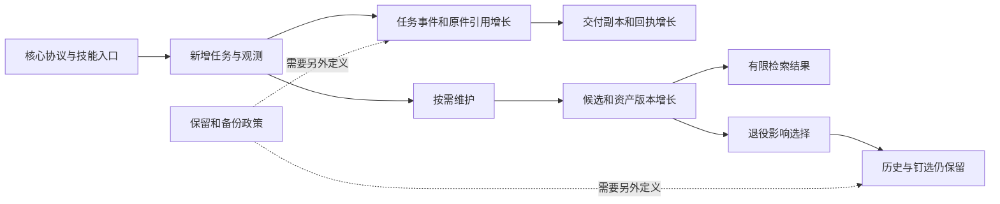

# R10：长期演化、增长控制与维护负担

日期：2026-10-29。冻结基线`22b7ece5d8388379f7b4bcaf47de4c047173cd9b`。
范围见[R10任务书](R10-brief.md)：七项检查，八对象各走Q01–Q08。
状态：主审、真实性复查及补做的独立复验取证完成；新增MAJOR/P2版本准入时序问题未修复，FDP子类型保留，用户未裁定。

## 当前判断

外置方法、稳定协议和适配器分离，为局部扩展提供了基础；这与“长期整体不会膨胀”仍是不同断言。
本轮观察到核心入口没有随合成任务增长，但任务历史、交付副本、资产事件和复核资料会增长。
退役仅影响选择，行数预算仅约束选定文件，SQLite备份/回收能力也不会自动替项目定义保留与兼容政策。

有限实测支持：原件去重、数据库快照恢复、交付投影重建、适配器局部替换和旧观测保留。
尚不能证明未来长期的自主去重淘汰、自然维护负担、所有宿主/规范变化兼容或无限数据持续可用。
既有R02-D02历史包增长、R07-D01检索归一化及其他未闭合发现继续保留。
新增 **R10-D01，MAJOR/P2，实现级版本准入顺序问题**：不支持的库版本仍先执行旧版DDL，才拒绝或因未知结构提前报错。
主审和全新上下文独立复验均重现；没有数据丢失证据，也不要求实现未来版本迁移。

## 方法、主体与证据范围

沿用FDP v1.0.3复核支线B、方法内验证特化；域为人机协作。主审为root，补做独立复验由全新上下文
`r10_independent_resume`承担，用户为裁定者。已装载的方法正文/载体/REVIEW摘要核验仍为：
`0eefcd7c35cf57bcf1db219c5e8d3fad708c863ffd4708cd0c5234bd7151caf4`、
`8138c90436a9bd5c30141df7e269409c083af050e6052f43a5f0be7b4a904922`、
`d805efae4ea778bb50872125cf695dca819906c1d64db4d50d61fe1fc84d2871`，changelog顶部仍为v1.0.3。
第一次独立代理`r10_independent_review`曾因平台用量限制终止，没有交出候选或结论。
本次用户要求补审后，新主体逐行读冻结51文件、4031行及干净八对象，先封存自己的候选、读清单和摘要，之后才接收主审材料与旧项映射。
前次18项主审交接原件另行保留，未通过覆写原始结果把当时“未完成”改成“已完成”。

主审复用摘要未变的全运行时/协议阅读，重读store、kernel、capabilities、架构/操作/两ADR、治理配置、dev/check、pyproject和CI；
runtime/library的相关消费路径按已核身份复用并核行号。下列外部原件按选段阅读，没有声称全规范认证。
四十个任务、库噪声和接口演练均为主审程序化合成夹具；model字段表示主审转报的夹具文本，不是四十次真实模型业务工作。
没有重跑整套产品回归，没有真实成员、跨年运行、断电恢复或并发写入备份压力测试。

独立主体另做检索、退役、备份、关闭后反馈增长与不支持库格式的针对性探针，读取相关一手原件并新取SQLite/Python/Agent Skills原件。
交换后以只读immutable连接复核原库40、备份库同源40、库夹具8及适配器2个任务记录；这些不是90个独立业务样本。
各阶段输入、封存候选、原件读范围、脚本和观察保存在`independent-resume/`；模型自评和有限夹具均未升级为长期效果认证。

## 一手来源和成熟备选

| 来源及读范围 | 同职责比较 | 限制 |
|---|---|---|
| [SQLite Online Backup](https://www.sqlite.org/backup.html)，29–68行 | 在线备份API复制一致数据库，避免把活库随手文件复制当可靠方案 | 本轮源连接打开但无并发写者；原文的API细节/C例程未全文审查，未测断电 |
| [Python3.12 sqlite3.backup](https://docs.python.org/3.12/library/sqlite3.html)，派生750–790 | 标准库已提供备份、分页及progress；不用自造SQLite文件复制器 | API存在不等于项目内置了备份命令、计划或恢复承诺 |
| [SQLite VACUUM](https://www.sqlite.org/lang_vacuum.html)，24–49、67–108 | 回收已删除数据的空页；VACUUM INTO是压紧的一致副本，操作中断有明确边界 | 不是自动选择哪些历史可删的策略，也不会从逻辑上删除仍在表内的退役资产 |
| [SemVer2.0.0](https://semver.org/spec/v2.0.0.html)，80–119 | 先声明公共API、发布内容不可静默改写、0.y.z开发期不稳定与1.0后的兼容含义分开 | 不给SQLite数据、事件格式或资产版本自动生成迁移政策；alpha不是所有保留义务都不存在 |
| [Azure Event Sourcing](https://learn.microsoft.com/en-us/azure/architecture/patterns/event-sourcing)，27–31、69–87 | 持久事件的版本/读取转换、补偿事件、快照与重放成本；快照是优化，事件流仍是依据 | 一手架构指导而非强制协议；原文也说明复杂度代价，不能据此要求完整企业事件平台 |
| [NIST SP800-218 SSDF v1.1](https://doi.org/10.6028/NIST.SP.800-218)，PDF派生物理行293–305、707–721、768–793前两列 | 以结果和风险适配组织规模，工具链减人工负担，明确检查准则及证据 | 只读这些条款/表格列，未全面SSDF评估；不是要求小项目复制所有组织流程 |

已有SQLite事务/原子提交、FTS5、LangGraph/LangMem、Matt和Agent Skills选段按前轮身份与限界复用。
没有通过付费ISO页的标题冒充ISO/IEC25010全文符合性，也未从OpenTelemetry名称推导现有成本观测完备。
备选按责任选用：原生backup/VACUUM；可验证的状态快照和保留清单；成熟索引；格式版本与读取转换；
按需适配器及单源工具链。它们不要求全部进入核心，也不能只列工具名就算责任已闭合。

## 增长关系与生命周期实测

运行器内同内容blob会去重；每个任务的事件、回执和交付文件仍分别产生。
本轮四十个正常闭合的合成任务共用65562字节内容，观察如下（最后一行在投影重建前测量）：

| 任务数 | 事件行 | blob数／内容字节 | SQLite文件字节 | 交付目录总字节 |
|---:|---:|---:|---:|---:|
| 1 | 9 | 1／65562 | 118784 | 68293 |
| 10 | 90 | 1／65562 | 159744 | 682930 |
| 20 | 180 | 1／65562 | 212992 | 1365860 |
| 40 | 360 | 1／65562 | 315392 | 2731720 |

这说明原件去重和交付副本增长可同时成立，不是长期空间上限或真实成员使用分布。
在源连接打开、无其他写者的条件下，用标准库backup复制数据库到新home，重放全部四十个任务，当前完成态均保持；
再导出一件成果，摘要与原件相同。原目录的一份导出文件移到保留位置后，deliver也能从数据库重建原件。
这证明有限场景的数据库恢复和投影可再生；未备份任意未捕获工作区文件、外部工具状态或第三方服务。
本项目当前没有内置备份/恢复命令或保留计划，不能把主审调用成熟API的试验说成已有产品自动保障。

### 资产噪声、退役与回收

六份明确标注的合成过时同词替代项排在目标方法前，查询needle的前三项没有目标；
细化查询加入decision/current后目标进入前三项；退役这些噪声后原查询也可找到目标。
这是主审预先知道答案后的查询/退役正控，不是智能体自然发现、语义排名或自主去重成功。
同样，能存案例和修订工作流，不等于已经有批量合并、过期审查和效果驱动淘汰机制。

退役后旧任务pin仍能读取；库里7资产、20状态事件、7blob、57任务事件在VACUUM前后数量不变，
数据库大小在本夹具中也同为81920字节。VACUUM不能替项目判断哪些历史必须保留。
R07的5000活跃头/版本、历史包和无关任务对照按原范围复用；本轮没有重做速度排行榜或取得新的语义评测结果。

## 预算、替换与版本演化

### 行数预算的反例

仅在演练副本，把541行runtime实现移至不在四文件预算内的模块，原入口改为重导出Workshop。
普通start/cancel仍能运行，结构/预算门无错误，预算内行数却从978降为442；控制职责并没有消失。
没有把这份副本当产品修复，也没有声称它跑过全部类型/样式/回归门。

所以1500行和6500字节预算可作增长警报，不能独自证明正交完备或实际控制面规模。
真正需要核对的是谁拥有准入、状态变化、持久记录、恢复和判断，新增适配器是否跨越这些职责；
把代码挪出计数范围不是长期设计进步。当前文档本身已说明预算不是永久完备性证明，不将此反例另报违约缺陷。

### 局部能力替换

在同一未改运行器中加入ratio.compute读能力，两个确定性模拟provider分别返回percentage和嵌套numerator/denominator。
适配器各自归一后发布JSON，原生JSON检查完成，两个新任务分别得到0.7和0.75；第二版工具启用后，旧任务原观测仍能重放为第一版。
核心与SKILL没有新增场景分支。这支持该单一接口变化可以局部吸收，不是所有工具、授权、宿主或规范变化皆无核心修改的证明。
真实模型宿主替换、原生发现/更新交给R12；扩展参数和值契约的既有R06-D01及效果分类R14-D01仍未修。

### 兼容政策与R10-D01

当前包版本为0.1.0a1；协议schema、SQLite metadata、分享format和族内资产计数是不同版本轴。
分享包用format值识别版本，字段类型校验的限界另见R09-N04；库metadata非1设有version拒绝门，但门晚于DDL，未知结构可能提前报错。
当前没有可执行的历史数据迁移、事件读取转换或完整后续兼容政策。
alpha允许重设计，仍需说明升级时已有成果/记录怎么办，不能用包版本的一个数字替代全部政策。

**R10-D01**由原主审候选R10-C01及独立候选I-02合并确认。位置为`_store.py:25–47`：执行v1建表和索引脚本后，才检查既存metadata版本。

| 起点或正控 | 预期及实测 |
|---|---|
| 不支持的metadata=2、其余旧表不存在 | 版本门应先拒绝；实测新增assets、asset_events、blobs、events四表后才报version，原哨兵保留 |
| metadata=2、自有asset_events形态不含v1的ref列 | 不应先对未知格式运行v1结构假设；实测先增三表，再因旧索引引用ref抛OperationalError，未到版本门 |
| metadata=1正常库 | 正常初始化、搜索和任务执行；前述备份恢复也保持原件与完成态 |

独立主体在接收主审结论前已分别构造两类不支持格式；主审交换后又用正常CLI的assets search在三个新夹具中复验。
准入职责由既有metadata检查建立，不以文案未另写“零副作用”豁免版本门晚于旧格式写入；但也不能把这些记录说成已经损坏或丢失未来数据。
MAJOR按本项目接口/错误处理顺序不一致映射，P2；仅在打开不支持的持久库时触发。实现行为缺陷不自动归为FDP成文级，子类型留待裁定。
可证伪预测：先读取既存版本并拒绝未知值后，两类不支持输入均应在v1 DDL前返回version，逻辑结构和哨兵内容不变；支持版本正常工作。

CLI空stdout和SQLite回溯外溢属于既有R04-D03的异常归一化根因，本轮只补证，不另加一个错误回包缺陷。
即使捕获了SQLite异常，提前改写未知库结构仍然存在；即使修正版本门，其他SQLite失败的统一回包也仍需处理，二者分别移交。
最小修复方向是区分新库与既存库、先识别受支持版本再做相应DDL并正确清理失败连接；不要求引入完整迁移平台或支持v2。
本轮不改产品，发现保持open。

### 独立真实性复查与边界

| 独立项 | 结果及去向 |
|---|---|
| I-01 Unicode原词漏检 | Straße与希腊语Σύνοψη两起点，ASCII及同规则casefold UDF正控；归并既有R07-D01，不新增编号 |
| I-02 版本门晚于DDL | 主审与独立复验的不同形态输入一致，确认R10-D01；无数据丢失/损坏结论，FDP子类型保留 |
| 关闭后反馈增长 | 1/20/200条合成反馈时inspect为2281/23472/224557字节，事件3/22/202；说明保留与投影会增长，不宣称性能SLA失败或重复编号 |
| 备份、退役与预算 | 独立备份恢复任务及退役资产成功；退役不删blob，不能界定总存储；预算非职责完备证明 |
| 保留、迁移与自动治理空白 | 继续作为明确待证责任，不因无迁移器、无无限未来证明就升级为概念缺陷 |

反馈耗时只有每级单次观察，不能报告为总体分位数、模型费用或长期可用性保证。

## 治理自身的增长

本轮报告创建前，初版生产Python为12文件、1580行，四文件预算为978行；SKILL为2726字节，条件参考资料8486字节。
既有复核工作区已达33文件、776099字节、12804行；初版docs的六份Markdown合计27588字节。
前一组是主审当时保存的历史测量，没有同时封存该时刻逐文件清单；独立主体未重算认证这一历史总数。
后一组初版文件与生产Python计数已由冻结文件独立复算。历史测量不能替代真实维护工时证据。
这些是不同口径、不同职责，不能拿总数相除假称产品运行负担增加了同样倍数。
复核资料不进入已安装skill，成员任务不必常驻加载它们，但开发者确实需要维护来源、状态、生成视图、报告和忽略的原始证据。

因此，“核心不变”不能用来豁免外围治理成本。应继续用单源和按需索引，保留一次性审查记录的档案性质，
避免让每次例外成为新的永久核心条款或让使用者承担组织工作。
NIST SSDF所强调的是明确结果/准则及工具链，不是文档数量；Matt优先已有机械检查而非反复加指令的方向仍适用。
本轮只登记规模和责任，没有真实维护工时/稳定周期数据，不能宣布治理开销已经相称，也不据此删除任何审计证据。
独立主体对“初版单包治理相称”的判断限定于冻结的短入口、配置和开发门；不与后续一次性复核材料的额外维护成本混算。

## R10-01–07结论

| 检查 | 主审结论及待证项 |
|---|---|
| R10-01 增长关系 | 固定入口、外置资产与事件/导出副本增长有证据；未证明总成本长期有界，R02-D02仍开放 |
| R10-02 信息堆积 | 查询细化、退役和历史pin可用；自主合并/去重/过期审查和真实相关性仍待证 |
| R10-03 预算 | 搬移副本证明数字可下降而职责不变；预算必须与职责审查组合 |
| R10-04 外部变化 | 一个模拟provider接口变化局部吸收并保留旧观测；真实宿主/所有规范变化未证 |
| R10-05 数据寿命 | 标准库备份恢复和投影重建有限正控；保留/清理/备份计划、未捕获文件及灾难恢复未闭合 |
| R10-06 未来兼容 | 多版本轴及alpha身份清楚；确认R10-D01版本准入顺序问题未修，升级/旧数据政策仍不足以认定长期达标 |
| R10-07 治理相称 | 单源和按需加载有结构支持，外围复核成本已显著积累；实际工时/收益比例未取得 |

## 八对象Q01–Q08比较

### A08 稳定核心与外围增长

| 项 | 比较与决定 |
|---|---|
| Q01 | 准入、持久、调用与组合由稳定控制面负责，方法/工具/案例在外围；稳定不是不许修缺失职责 |
| Q02 | 已核Matt/Agent Skills按需加载、NIST结果导向与Azure事件代价；不冒充ISO全文符合 |
| Q03 | 外置方法、成熟适配器、轻量数据库或全事件平台按职责成本选，不默认越多越成熟 |
| Q04 | 扩展不能隐形搬走核心责任；常驻上下文、查询、历史和维护成本均需核 |
| Q05 | 978→442搬移反例，40任务核心未改，单工具版本替换；有限样本不证永久完备 |
| Q06 | 静态预算、运行路径、外部适配与治理共同约束，不能用单指标自证 |
| Q07 | 文档已承认预算为警报；独立复验亦不从搬移反例直接定新违约，有限规模不外推未来 |
| Q08 | 保留职责分离，补可执行增长/保留/兼容政策的设计证据；不扩写常驻指令 |

### M21 SQLite存储与事务

| 项 | 比较与决定 |
|---|---|
| Q01 | `_store.py:18–47,52–125`负责库初始化、事务、原件和事件；备份计划非自动提供 |
| Q02 | SQLite备份/VACUUM、Python3.12backup及前轮事务/原子提交是同职责一手源 |
| Q03 | 原生backup、VACUUM INTO、停机一致副本和迁移工具，避免自造活库复制机制 |
| Q04 | 记录/原件一致、恢复可验证、版本拒绝边界清楚；不能把落盘等同备份 |
| Q05 | 40任务备份重放、原件再导出、未知版本前DDL两起点；无断电/并发压力实证 |
| Q06 | 库保留捕获内容，工作区未捕获文件与外部效果要另列，交付投影可重建 |
| Q07 | R10-C01/I-02行为与准入责任核验后确认R10-D01；未证数据损害，错误回包部分归R04-D03 |
| Q08 | 复用成熟备份，先修版本准入顺序并回归支持/不支持格式；保留/迁移需明示，本轮不改库 |

### M29 资产状态、版本、退役与回退

| 项 | 比较与决定 |
|---|---|
| Q01 | `_library.py:52–74,137–181`负责采用、头选择及退役；退役不等于删除历史 |
| Q02 | Git对象/选择、SemVer边界和SQLite空间回收；本地计数不是兼容承诺 |
| Q03 | 退役、修订、归档、保留清单、可验证GC各有不同责任 |
| Q04 | 不能误删旧pin/原件，不能以inactive推断不可达；新任务选择与历史重建分开 |
| Q05 | 七资产退役正控、旧pin可读、VACUUM逻辑计数不变；R09版本竞争证据按原范围继承 |
| Q06 | 检索候选减少而数据库仍增，选择优化与存储寿命须组合处理 |
| Q07 | 保留历史是公开语义，不报退役不删为bug；无GC政策是长期待证责任 |
| Q08 | 保留不可变版本；按依据/合法保留需求设计后续归档/清理，不为减数破坏记录 |

### M35 资源限额与增长预算

| 项 | 比较与决定 |
|---|---|
| Q01 | 合同限制单blob/上下文/调用，governance限制选定文件；全局存储/模型费用仍不受这些数字保证 |
| Q02 | Python/SQLite实测、Azure快照重放指导及NIST工具/准则；未声称OpenTelemetry已接完 |
| Q03 | 请求片段、消费投影、状态快照、成熟索引与预算告警按真实瓶颈选择 |
| Q04 | 局部上限不能冒充总成本上限，也不能把历史删除当无损压缩 |
| Q05 | 40同内容task副本线性增，978→442预算搬移；继承R07历史/索引证据不重计 |
| Q06 | 次数/字节/存储/CPU/工时不同，持久历史与模型消费视图可分离 |
| Q07 | 没有新模型token/价格/自然工时，不做净收益结论；既有R02-D02未关闭 |
| Q08 | 保留局部警报，补责任和消费/保留策略，不靠新增预算项覆盖所有未来场景 |

### M44 文档、单源组织与公开边界

| 项 | 比较与决定 |
|---|---|
| Q01 | 协议字段、版本、工具锁和治理配置有各自单源，解释和复核记录不成为另一执行规范 |
| Q02 | NIST SSDF选段、Matt机械检查/导航及既有PyPA元数据原件；不声称全部安全开发认证 |
| Q03 | 生成视图、按需索引、一次性归档与最小检查入口，优先复用现有工具链 |
| Q04 | 成员不该维护审查账本，开发治理本身也需成本依据；专业公开措辞和独立仓约束保留 |
| Q05 | 初版12生产文件/1580行与既有33审查文件/776099字节分别测量，AGENTS不记录学习条目 |
| Q06 | 普通安装不含研究资料但开发者仍要维护；临时审查脚本不能伪装永久产品功能 |
| Q07 | 不以字节比例推真实成员延迟，也不以工具门通过证明组织成本已相称 |
| Q08 | 保留单源与短入口，复核资料按档案维护；避免再造常驻规则层或未经授权删证据 |

### C04 经验到下一次任务收益

| 项 | 比较与决定 |
|---|---|
| Q01 | 维护、采用、检索、执行及后续结果共同承担收益，增长不能只看资产数量 |
| Q02 | LangMem/LangGraph、Matt及CWL职责对照按R08/R09原件限界复用 |
| Q03 | 不变、修订已有、外置方法或成熟服务；有收益才增加持续维护机制 |
| Q04 | 成功可迁移不等于长期净收益，重复/冲突资产应能辨别且不污染当前事实 |
| Q05 | 前轮fresh接收及空库对照支持有限迁移；本轮噪声挤占/细化/退役补证，非新业务效益试验 |
| Q06 | 完成门、证据消费、检索与保留缺一不可；各段成功不自动乘成全链保证 |
| Q07 | R05/R06/R07事项未修；独立机制复验已补，合成维护仍非自然学习或真实长期效果评估 |
| Q08 | 保留外置回流，真实长期样本/触发和成本仍列义务，不扩称自主成熟 |

### C07 规模增长及外部能力替换

| 项 | 比较与决定 |
|---|---|
| Q01 | 外部接口由适配器吸收，控制协议守准入/记录；规模增长由存储/消费/选择各管责任 |
| Q02 | SQLite原生备份、Azure事件版本/快照、已核能力接口和按需skill规范 |
| Q03 | 新适配器、新方法、成熟索引/投影、缺职责时审核心；不要求永远零核心变更 |
| Q04 | 新接口不能改写旧观测或扩大授权，计数稳定不代表效果/故障语义稳定 |
| Q05 | 两模拟provider各得0.7/0.75，旧观测仍第一版；40task增长和搬移反例分别留证 |
| Q06 | 宿主协议、provider结果、注册能力和持久事件独立演化，单一happy path覆盖有限 |
| Q07 | 没有真实原生宿主替换/全部规范升级证明；R06值契约和R14效果分类仍开放 |
| Q08 | 保留局部适配，按真实变化做受影响不变量复验；原生宿主接续R12且不提前认证 |

### U04 长期数据保留与版本演化

| 项 | 比较与决定 |
|---|---|
| Q01 | 已捕获原件/事件/版本可重建，长期保留、备份、清理和升级需清楚政策 |
| Q02 | SQLite/Python备份、SemVer开发期/公共API、Azure不可变事件和读取转换是同职责一手源 |
| Q03 | 备份快照、外部归档、事件upcaster/补偿、显式迁移及格式拒绝按数据/成本选择 |
| Q04 | 不改原记录冒充无损升级；快照不是永久替代历史；未知版本拒绝不应被误称已有迁移 |
| Q05 | 40task恢复、重导出及独立未知版本两起点；无跨版本真实迁移或长期保留运行证据 |
| Q06 | 包/协议/库/资产版本不是一个轴，部署升级和数据可用性必须共同考虑 |
| Q07 | alpha不承诺稳定API但仍需说清旧数据处置；R10-D01已证准入时序，未证数据破坏 |
| Q08 | 暂不宣称长期地板达标；补明确政策及恢复演练，再决定是否引入成熟迁移实现 |

## 移交与终止方式

主审证据位于本机忽略目录`.evaluation/reviews/R10/`，含精确基线、干净八对象、六份一手原件及阅读范围、
增长/备份/退役/适配/搬移/未知版本探针和治理测量。演练副本和产品严格区分，产品未改，未提交推送。

本轮主审、真实性复查及独立取证阶段完成后择停，不作整个FDP或产品验收通过声明。
R10-D01、既有未闭合发现及真实长期效果/保留/兼容政策义务分别移交，用户未裁定，不自动修复、提交或创建外部Issue。
补审已满足本轮独立复验的程序关口；下一轮按总计划进入R12分发安装与跨宿主实际使用，不据此宣称已验证那些宿主。
