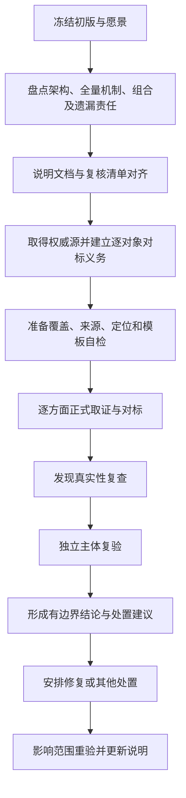

# 正式复核工作区

本工作区对 AstroFairy 初版开展全量复核。准备阶段已完成，2026-10-28 依用户推进指令启动 R01。
当前轮次、主审/独立复验进度及未闭合事项以[轮次索引](INDEX.md)和[状态台账](preparation-status.json)为准。
本入口不再复制可变的当前轮次与下一轮编号，避免导航与正式记录漂移；取证完成不代表产品已修复或验收。
本工作区保留冻结初版的取证结论。[修复工作区](../repairs/README.md)单独记录后续实现与重验状态。
真实成员、跨宿主原生行为、长期学习及整体净收益尚有待证项，不能从轮次取证完成推断整体行业达标。
这些历史报告不追写为新实现的通过结论；后续修复不自动提交或发布材料。

## 阅读顺序

1. 先读[项目逻辑说明](../guides/understanding-astrofairy.md)：从一个任务理解分工、执行、检查、恢复和学习。
   想直接了解本次复核判断与处置顺序，读[整体结论](overall-assessment.md)；逐项检查见[全量结论](check-results.md)。
2. 再读[全量对象台账](system-inventory.md)：知道所有架构、机制、组合和需求探针分别在哪里。
3. 然后读[总复核计划](initial-review-plan.md)：掌握愿景、方面、共同对标要求与场景。
4. 需要追问依据时打开[权威来源目录](authority-sources.md)与[正式轮次记录模板](review-record-template.md)。

说明文档服务于理解，清单规定检查要求，台账保证对象覆盖，来源目录保存取证入口。
它们按编号引用，不建立互相竞争的产品规范。

## 整体流程



准备自检只说明材料可用于取证；正式轮次分别给出有限范围结论，不据准备完成推断架构正确或行业达标。

## 范围与工作节奏

- 产品基线是 `22b7ece5d8388379f7b4bcaf47de4c047173cd9b`，共 51 个入仓文件。
- 全量对象包括 9 个架构对象、45 个机制、8 条组合路径、7 个从愿景导出的待证责任。
- 清单包含 17 项愿景、117 项分方面检查、8 项逐对象行业对标检查和 16 类场景。
- 每个对象都走完整的 Q01–Q08 对标流程，不能凭熟悉程度筛选。源码登记与语义覆盖在正式复核中分别验证。
- 默认从 R01 愿景与承诺开始，再做 R02 架构；后续按总计划分轮。行业对标贯穿每轮。
- 每轮由智能体负责取证与记录，向用户说明主要结论、证据与需要裁决的关键问题。
- 产品代码、skill 指令及运行接口保持初版；准备包新增的文档和检查工具属于复核基础设施，同样需自检。

## 现有证据如何使用

已有首版报告、47 项本地自动测试、公开仓库 CI、五目标安装、真实模型试用及公开源安装记录。
它们只支持当时版本和已执行场景。正式轮次先核对版本、输入、隔离性与观测，再复用确实有效的部分。
需要补证的行为不以“已有测试”默认通过，也不无理由重复全部检查。
私有工作材料和本机缓存未加入公开分发；证据不可取得时如实登记。

## 准备包自检

```sh
.venv/bin/python dev/check_review_preparation.py
.venv/bin/python dev/check_review_preparation.py --verify-snapshots
```

第一条检查对象、来源、实现定位、冻结代码和生成视图；第二条还逐份核对本机来源原件的摘要。
更新数据后用 `--render` 重建人类可读视图。JSON 是对象和来源元数据单源，Markdown 是派生阅读视图。
这两条是开发复核工具，不进入 skill，也不因缺少本机研究缓存而要求普通使用者配置研究环境。
源码定位和登记自动检查只能发现一部分遗漏，正式复核仍须从愿景和实际系统重新推导覆盖。

准备结果与范围说明记录在[准备状态](preparation-status.json)。
第一轮的任务边界见[任务书](first-round-brief.md)，实际结论见[R01 报告](R01-vision-and-claims.md)。
正式轮次报告以本工作区为归档入口；发现、撤回、复验和后续处置在各轮报告中关联。

## 方法与边界

设计复核的方法来源为维护者的 FDP 复核支线。正式执行前加载方法原件和执行载体，核验版本。
FDP 是工作方法，不是外部行业标准。规范和成熟方案均回到对应的权威一手资料。
本项目不复制母项目的方法定义、仓库治理、记录模板和 Issue 地址，方法要求的项目落位见轮次模板。
无法取得原件、条款或关键试验环境时登记缺口；不以摘要、记忆或代理文本补作已读声明。
